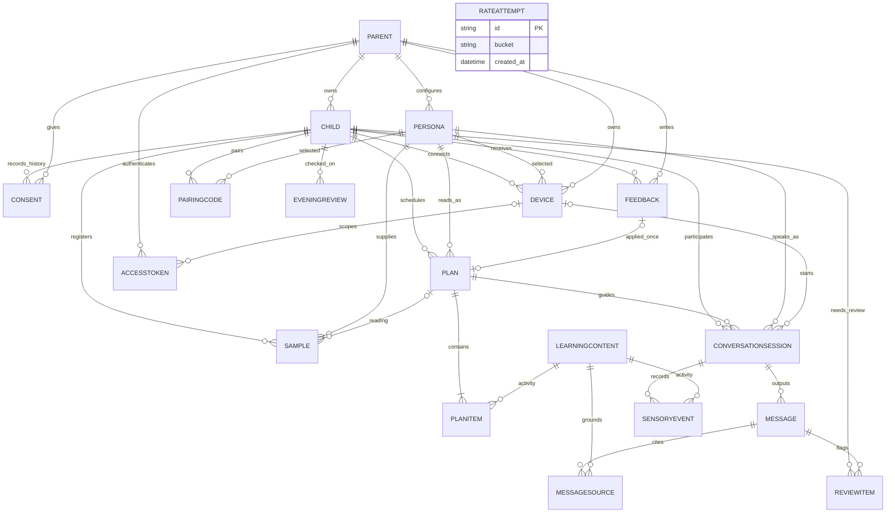

# FastAPI 백엔드 실제 DB 관계

2026-10-31 · `server/app/models.py` 기준. 별도 Fastify 시제품의 메모리 ERD와 구분한다.

SQLModel로 **19개 테이블**을 생성한다. 기본 DB는 SQLite이며 FK를 켠다. 레코드 ID는 UUID 문자열, 생성/만료/종료 시각은 UTC, 계획/피드백 날짜와 대화 시간대는 서울 기준이다. 시연 자료만 `demo-apple`, `demo-banana`, `demo-cookie` 고정 ID를 쓴다.

14개 도메인 테이블에 계획/자료·발화/근거 연결 테이블 2개와 인증 토큰·연결 코드·입력 시도 3개를 추가했다. `RATEATTEMPT`의 bucket은 용도와 IP의 해시이며 부모/기기 FK 없이 요청 제한에만 사용한다.

| DB 제약 | 보장 |
|---|---|
| `Parent.email` unique | 이메일 중복 가입 방지 |
| `AccessToken.token_hash`, `PairingCode.code_hash` unique | 토큰·코드 해시 유일성 |
| `Plan(child_id,date)` unique | 아이별 날짜당 계획 하나 |
| `Plan.feedback_id` unique, nullable | 피드백 적용 최대 한 번 |
| `PlanItem(plan_id,content_id)` 복합 PK | 계획에 같은 자료 중복 방지 |
| `PlanItem(plan_id,position)` unique | 활동 순서 중복 방지 |
| `Message(session_id,sequence)` unique | 세션별 발화 순서 중복 방지 |
| `MessageSource(message_id,content_id)` 복합 PK | 근거 자료 중복 방지 |
| `EveningReview(child_id,date)` unique | 날짜별 저녁 확인 중복 방지 |
| 활성 세션의 `child_id` 부분 unique index | 아이당 활성 세션 하나 |

부모 범위, 아이·기기·계획·페르소나 일치, 피드백의 아이와 다음날 날짜, 현재 동의·사용 시간·세션 상태는 서비스에서 검사한다. 계획+계획 자료, 연결 코드 소비+기기+토큰, 응답+근거+확인 항목은 각각 한 트랜잭션으로 저장한다. 충돌은 409, 일시적인 SQLite 잠금은 503으로 반환한다.

배열인 아이 관심사, 교육 방향, 아바타 선택값, 피드백 선택지/단어는 JSON 열이다. 아이 발화 원문은 저장하지 않고 `MESSAGE`에는 서버 에이전트 출력만 남긴다. 부모 녹음·입모양 수치는 비공개 파일 저장소에 두며 `SAMPLE.storage_key`는 그 상대 경로다. 인증 원본 토큰/연결 코드/비밀번호를 그대로 저장하지 않는다.

DB 생성은 신규 설치용 `create_all`이다. 기존 DB의 스키마 변경을 자동 이관하는 마이그레이션은 별도 준비가 필요하다. 데이터 보존/삭제, 계정 복구, 실제 운영 인증과 법적 동의 정책은 이 로컬 구현과 구분한다.
