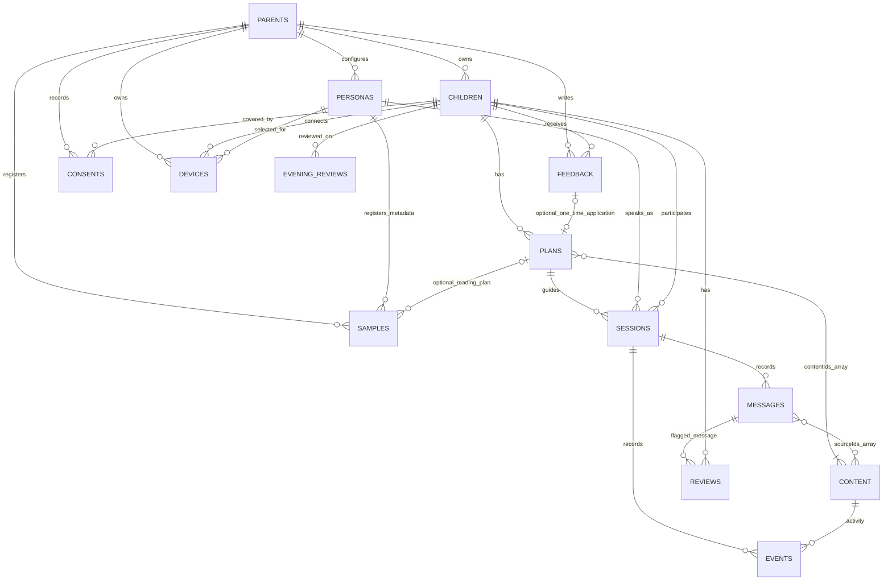
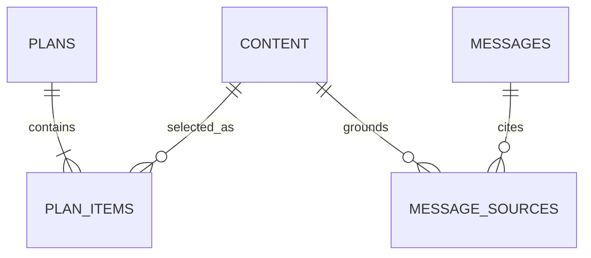

# 아이봄 백엔드 구현 현황과 ERD

팀 공유용 · 2026-10-31 · 현재 로컬 코드 기준

> 문서 출처: 사용자가 제공한 별도 `In_Thon/backend/` 시제품의 구현 현황이다. 이 저장소의 `server/`는 Python/FastAPI이며, 아래 Fastify 구현·18개 테스트·실행 결과는 이 저장소에서 재검증한 내용이 아니다. 참고 파일 경로도 별도 시제품 기준이며 이 저장소에 없을 수 있다.

> 이후 이 저장소에 구현한 영속 FastAPI 백엔드는 [server/README.md](../server/README.md)와 [현재 API 명세](api.md)를 참고한다. 아래 내용은 제공 당시 시제품 기록으로 보존한다.

## 1. 현재 상태

**부모 가입 → 태블릿 연결 → 아이 활동 → 부모 확인·피드백 → 다음날 계획·낭독**까지 연결되는 로컬 백엔드 틀을 구현했다.

현재 코드는 **TypeScript/Fastify + 메모리 저장소**다. 실제 DB, 음성·영상 파일 업로드, STT/TTS, 입모양 분석, 자유 대화 LLM은 아직 연결하지 않았다. 완성된 AI 육아 서비스가 아니라 화면·API·데이터 흐름을 확인하는 시제품이다.

| 구분 | 위치와 상태 |
|---|---|
| 구현한 로컬 백엔드 | `In_Thon/backend/` — TypeScript/Fastify, 현재 문서의 설명 대상 |
| 팀 저장소 | `In_Thon/ai-mom/` — 별도 clone한 저장소 |
| 팀 백엔드 | `In_Thon/ai-mom/server/` — Python/FastAPI, 로컬 데모 미반영 |
| 팀 저장소 확인 기준 | 로컬 main, 커밋 `25c2adc`. 원격의 이후 변경까지 반영했다고 주장하지 않음 |

**팀 적용 시에는 기존 흐름과 테스트를 참고해 FastAPI 구조로 옮겨야 한다.** 현재 코드를 팀 서버에 통합한 상태는 아니다.

## 2. 백엔드 구성

프런트는 화면·녹음·카메라·애니메이션·진동을 맡고, 백엔드는 데이터·권한·처리 순서를 맡는다.

```text
부모 앱 / 아이 태블릿
        ↓ HTTP 요청
Routes     입력 형식·필수값 검사
        ↓
Services   부모 소유권·기기 범위·처리 순서 검사
        ↓
Repository 저장/조회 계약
        ↓
MemoryRepository — 현재 구현, 재시작 시 초기화
```

| 모듈 | 구현 내용 | 코드 위치 (`backend/src/` 기준) |
|---|---|---|
| 프로필 | 부모·아이·페르소나·아바타 설정 | `modules/profiles/` |
| 가입·설정 | 교육 선택지·시간대·상한·동의 이력·가입 체크리스트 | `modules/onboarding/` |
| 태블릿 연결 | 연결 코드·아이 전용 토큰·연결 해제 | `modules/devices/` |
| 학습 계획 | 활동 목록·하루 계획·낭독 대본 | `modules/learning/` |
| 대화·활동 | 세션·발화·감각 이벤트·모드/속도 상태·종료 | `modules/conversations/` |
| 부모 검토 | 확인 항목·선택형 피드백·새 단어·집계 리포트 | `modules/parent-review/` |
| 홈·기록 화면 | 여러 기록을 묶은 홈 요약·시간순 타임라인 | `modules/dashboard/` |
| 흐름 관리 | 계획·대화·피드백의 소유권과 상태 처리 | `modules/aibom-service.ts` |
| 외부 연결 계약 | STT·TTS·입모양·학습·LLM·출력 검사 인터페이스 | `integrations/contracts.ts` |

## 3. 구현된 사용자 흐름

### 가입과 기기 연결

1. 부모를 등록해 로컬 데모 토큰을 받는다.
2. 아이의 이름·생년월·말하기 수준·관심사를 등록한다.
3. 부모의 호칭·말투·교육 방향·아바타 선택값을 등록하고 페르소나를 확정한다.
4. 음성·입모양 영상의 **메타데이터**를 등록한다. 실제 파일 업로드나 품질 분석은 하지 않는다.
5. 두 가지 데이터 동의, 대화 시간대, 하루 상한, 진동 설정을 저장한다.
6. 부모가 발급한 6자리 코드로 태블릿이 아이 전용 토큰을 받는다.

코드는 5분·1회용이고, 코드 입력은 IP당 1분 5회로 제한한다. 기기 토큰으로 부모 API에 접근할 수 없으며, 부모가 연결을 해제하면 해당 기기 토큰을 거부한다. 동의를 철회하면 태블릿 요청의 가입 준비 검사도 실패한다.

### 낮 활동과 저녁 피드백

```text
하루 계획 + 해당 페르소나의 낭독 접수
  → 태블릿 세션 시작
  → 아이 발화·감각 이벤트 저장
  → 범위 밖 질문은 안내 문구 + 부모 확인 항목
  → 부모가 대화·리포트 확인
  → 피드백과 새 단어 기록
  → 피드백을 연결한 다음날 계획 생성
  → 다음날 대본 낭독 정보 등록
  → 다음날 활동
```

- 태블릿은 서울 날짜 기준 오늘 계획만 시작한다. 부모 API는 개발·시연 편의상 미래 계획도 테스트할 수 있다.
- `too_fast` 피드백은 다음 계획의 속도 상태를 slow로 바꾼다. 다른 선택지는 기록까지만 하며 자동 코칭으로 해석하지 않는다.
- 청각 모드에서는 시각·촉각 이벤트를 거부한다. 속도·진동 설정의 실제 단말 적용은 프런트/TTS 연결이 필요하다.
- 홈의 저녁 할 일은 기록 확인, 피드백 작성, 다음날 낭독 접수로 구성된다. 낭독 접수는 학습 완료와 다르다.

## 4. 현재 구현 기준 ERD

**14개 메모리 컬렉션의 논리 관계**다. 관계선은 ID 참조를 설명하며, SQL 테이블·외래키·DB 제약이 생성된 상태는 아니다. 소유권과 관계는 서비스 코드에서 검사한다.



`||`는 하나, `o{`는 0개 이상을 뜻한다. 계획에는 자료 ID가 1개 이상 들어가고, 발화의 근거 ID는 없을 수도 있다. 하나의 피드백을 여러 계획에 반복 적용하는 것은 현재 서비스에서 막는다.

### 모델별 저장 항목

모든 모델에 `id`, `createdAt`이 있다. 사용자 생성 레코드는 UUID를 쓰고, 시연 학습 자료는 `demo-apple` 같은 고정 문자열 ID를 쓴다. `?`는 선택값이다.

| 컬렉션 / TypeScript 타입 | 역할 | 핵심 필드 |
|---|---|---|
| `parents` / Parent | 부모 데모 계정 | `displayName` |
| `children` / Child | 아이 프로필·사용 설정 | `parentId`, `nickname`, `birthMonth`, `speechLevel`, `interests[]`, `hapticsEnabled`, `dailyLimitMinutes`, `conversationWindow?` |
| `personas` / Persona | 부모 아바타·말투·교육 방향 | `parentId`, `parentTitle`, `speakingStyle`, `englishEnabled`, `educationGoals?`, `avatar`, `status` |
| `samples` / Sample | 음성·영상 등록 정보 | `parentId`, `personaId`, `kind`, `purpose`, `planId?`, `storageKey`, `sentenceCount`, `consentedAt`, `status` |
| `content` / LearningContent | 활동·데모 근거 문장 | `topic`, `word`, `englishWord`, `activity`, `senses[]`, `minAgeMonths`, `maxAgeMonths`, `prompt`, `source`, `license`, `reviewStatus` |
| `plans` / Plan | 하루 계획·낭독 대본 | `childId`, `date`, `contentIds[]`, `feedbackId?`, `pacing`, `readingScript`, `readingStatus` |
| `sessions` / Session | 아이 활동 한 묶음 | `childId`, `planId`, `personaId`, `mode`, `status`, `pacing`, `endedAt?` |
| `messages` / Message | 아이·에이전트 발화 | `sessionId`, `sequence`, `speaker`, `text`, `sourceIds[]`, `safetyStatus`, `deliveryStatus` |
| `events` / SensoryEvent | 클라이언트가 보고한 감각 반응 | `sessionId`, `contentId`, `sense`, `action`, `reactionMs?` |
| `reviews` / ReviewItem | 부모가 확인할 장면 | `childId`, `messageId`, `reason`, `status` |
| `feedback` / Feedback | 저녁 의견·다음 학습 방향 | `parentId`, `childId`, `comment?`, `concerns?`, `newWords?`, `forDate?`, `requestedTopic?`, `pacing`, `appliedPlanId?` |
| `consents` / DataConsent | 두 동의의 변경 이력 | `parentId`, `childId`, `parentBiometrics`, `childSignals`, `policyVersion` |
| `devices` / PairedDevice | 연결된 아이 기기 | `parentId`, `childId`, `personaId`, `label`, `revokedAt?` |
| `eveningReviews` / EveningReview | 부모의 날짜별 기록 확인 | `childId`, `date` |

토큰 해시, 연결 코드, 입력 횟수 제한은 위 컬렉션과 별도의 서비스 메모리 Map에 있다. DB나 운영 인증을 연결한 상태가 아니다.

### 화면과 연결되는 값

| 값 | 현재 표현 |
|---|---|
| 말하기 수준 | `single_words`, `two_words`, `short_sentences`; 이전 API 호환용 `babbling`도 허용 |
| 아바타 | `preset`, `background`, `faceShape?`, `hair?`, `eyes?`, `outfit?`, `color?`의 선택 ID |
| 교육 방향 | `korean_expression`, `english_exposure`, `songs_and_play`, `audio_focus` |
| 녹음 종류·목적 | `audio / lip_video / expression_video`, `onboarding / night_reading` |
| 계획 낭독 | `required → submitted`; 업로드·학습 완료를 의미하지 않음 |
| 세션 | `active → ended`, `multisensory / audio_only`, `normal / slow` |
| 감각 이벤트 | `auditory/repeat`, `visual/gaze`, `tactile/활동 동작` |
| 부모 피드백 | `too_fast`, `too_difficult`, `haptics_too_strong`, `voice_unnatural` |
| 에이전트 출력 | `prepared`: 텍스트 준비 상태. 실제 음성 재생 확인이 아님 |

## 5. DB로 옮길 때의 ERD 제안

현재 배열로 저장하는 두 관계를 연결 테이블로 분리하면 **기존 14개 엔티티 + 연결 테이블 2개 = 16개**의 초기 DB 설계가 된다. 이 부분은 아직 구현하지 않은 제안이다.

| 현재 구현 | 제안하는 DB 구조 | 이유 |
|---|---|---|
| `Plan.contentIds[]` | `PLAN_ITEMS(plan_id, content_id, position)` | 활동 순서와 계획별 자료 관계를 명시 |
| `Message.sourceIds[]` | `MESSAGE_SOURCES(message_id, content_id)` | 응답마다 어떤 자료를 근거로 삼았는지 추적 |
| 메모리 소유권/관계 검사 | PK·FK·유일성·트랜잭션 + 서비스 검사 | 저장 무결성과 동시 요청 처리 |
| 임시 bearer token | 팀의 실제 인증 계약 | 계정 인증·만료·갱신·복구·기기 권한 관리 |



DB 도입 시 필요한 핵심 제약:

1. `(child_id, date)` 계획 중복 방지. 계획 버전이 필요하면 버전/활성화 정책을 먼저 확정한다.
2. `(plan_id, position)`, `(session_id, sequence)` 유일성.
3. 피드백의 아이와 적용 계획의 아이가 일치하고, 피드백은 한 번만 적용되도록 처리.
4. 세션의 아이·페르소나, 기기·계획이 같은 부모 범위인지 검사.
5. `(child_id, date)`의 저녁 확인 기록 중복 방지.
6. 부모 피드백 적용과 계획 생성은 한 트랜잭션으로 처리.

`auth_subject`, TTS voice ID, 자료 버전, 미디어 보존/삭제 시각, 분석 작업 상태 등은 실제 모듈 계약에 맞춰 추가해야 한다. 기존 개념 ERD에 있더라도 지금 구현된 필드로 소개하지 않는다.

## 6. 주요 API

모든 경로는 `/api` 기준이다. 아래는 대표 경로이며 전체 설명은 `backend/README.md`에 있다.

| 구간 | 대표 API |
|---|---|
| 데모 시작 | `POST /demo/parents`, `GET /me`, `GET /ui-options` |
| 아이·아바타 | `POST /children`, `POST /personas`, `POST /personas/:personaId/confirm` |
| 동의·설정 | `PUT /children/:childId/consents`, `PUT /children/:childId/settings` |
| 녹음 등록 | `GET /recording-prompts`, `POST /personas/:personaId/samples`, `GET /personas/:personaId/training-progress` |
| 태블릿 연결 | `POST /children/:childId/pairing-codes`, `POST /tablet/pair`, `GET /tablet/context` |
| 계획 | `GET /learning-content`, `POST /children/:childId/plans`, `GET /plans/:planId` |
| 아이 활동 | `POST /tablet/sessions`, `POST /tablet/sessions/:sessionId/messages`, `POST /tablet/sessions/:sessionId/events` |
| 모드·종료 | `PATCH /tablet/sessions/:sessionId`, `POST /tablet/sessions/:sessionId/end` |
| 부모 화면 | `GET /children/:childId/home`, `GET /children/:childId/review`, `GET /children/:childId/report` |
| 저녁 과정 | `POST /children/:childId/evening-review`, `POST /children/:childId/feedback` |
| 연결 해제 | `DELETE /devices/:deviceId` |

home에는 `personaId`와 `date`, review/report에는 `date` 쿼리가 필요하다. report의 `period=week`는 지정일을 포함한 최근 7일이다.

## 7. 구현 범위와 남은 부분

| 영역 | 현재 상태 |
|---|---|
| 프로필·설정·동의·기기 연결·권한 분리 | 로컬 API 구현 |
| 계획·낭독 접수·세션·발화·감각 이벤트 | 데이터 흐름 구현 |
| 홈·기록·피드백·다음날 계획 | 기본 연결 구현 |
| 오늘/최근 7일 집계 | 저장된 이벤트 수와 세션 시간으로 계산 |
| STT/TTS·입모양·LLM/RAG·출력 안전 검사 | 인터페이스만 정의, 실제 제공자 미연동 |
| 녹음 파일·이미지·효과음·아바타 렌더링 | 업로드/생성/재생 미구현 |
| 교육 자료 | 사과·바나나·북의 내부 작성 데모 문장. 전문가 검증 자료 아님 |
| 학습률·발달 진단·집중도·자동 코칭 | 미확정/null. 등록량을 학습 성능으로 표시하지 않음 |
| 시간대·하루 상한 | 설정 저장/전달만. 실제 시간 제한 적용·자동 알림 미구현 |
| 영속 DB·운영 인증·배포 | 미구현. 로컬 루프백 전용 서버 |

감각 비율은 발달 점수가 아니라 **클라이언트 보고 이벤트 개수의 비중**이다. 이벤트가 없으면 비율은 null이다. 집계는 계획 날짜 기준이며, 자정을 넘는 세션 시간을 날짜별로 분할하지는 않는다.

부모 API는 로컬 개발 도구로 사용할 수 있고, 태블릿 경로에서는 전체 가입 체크리스트를 검사한다. 현재 동의 정책 `demo-v1`과 임시 토큰을 운영용 인증·법적 동의 체계로 취급하지 않는다.

## 8. 검증과 실행

현재 코드의 테스트는 **18개**다. 입력 검증, 소유권, 기기 토큰 범위, 연결 코드 만료·재사용·입력 제한, 동의 철회, 대화 상태, 감각 집계, 피드백/다음날 흐름을 다룬다.

검증 근거: 기존 작업에서 빌드·WSL Node 24.21.0 테스트와 실제 HTTP 시연을 확인했다. 이번 문서 정리에서는 Windows Node 25.8.1에서 타입 검사와 18개 테스트를 다시 실행해 통과했다. 팀 FastAPI 서버의 검증 결과와는 구분한다.

```bash
cd backend
npm ci
npm run check
npm test
npm run demo
```

`npm run demo`는 빌드 후 임시 로컬 포트에서 가입 → 연결 → 활동 → 홈/리포트 → 피드백 → 낭독 → 다음날 세션 → 연결 해제를 재현한다. 다음날은 데모 시계를 하루 넘긴다. 실제 녹음·AI 학습은 실행하지 않는다.

## 9. 팀과 맞출 사항

1. 이 문서의 API·데이터 흐름 중 팀 FastAPI에 옮길 범위를 확정한다.
2. `server/app/models.py`, `docs/api.md`, `app/src/lib/types.ts`의 계약을 함께 맞춘다.
3. STT/TTS·입모양·에이전트 담당과 파일 키·반환값·실패 상태를 맞춘다.
4. 학습률 기준, 필수 낭독 기간, 자료 검토/라이선스, 사용 제한 정책을 정한다.
5. 팀 저장소 지침은 main 직접 작업이지만, 사용자가 별도 브랜치를 지정하면 해당 브랜치를 따른다. **AI 자동 GitHub push는 하지 않는다.**

현재 구현은 팀 저장소와 별개이며, 팀 저장소 코드 수정·커밋·푸시는 하지 않았다.

## 10. 참고 파일

- 실제 데이터 타입: `backend/src/domain/models.ts`
- 저장소: `backend/src/lib/repository.ts`
- 화면별 흐름: `docs/backend-guide.md`
- 기존 정규화 ERD 제안: `docs/backend-erd.md`
- 팀 저장소 위치·역할: `docs/repository-handoff.md`
- 최신 기획서: 사용자가 제공한 `aibom_mamavoice.md`
- 와이어프레임: 이전 작업에서 확인한 공개 아이봄 아티팩트. 이번 문서는 새 웹 조회가 아닌 현재 로컬 코드를 기준으로 재정리했다.
