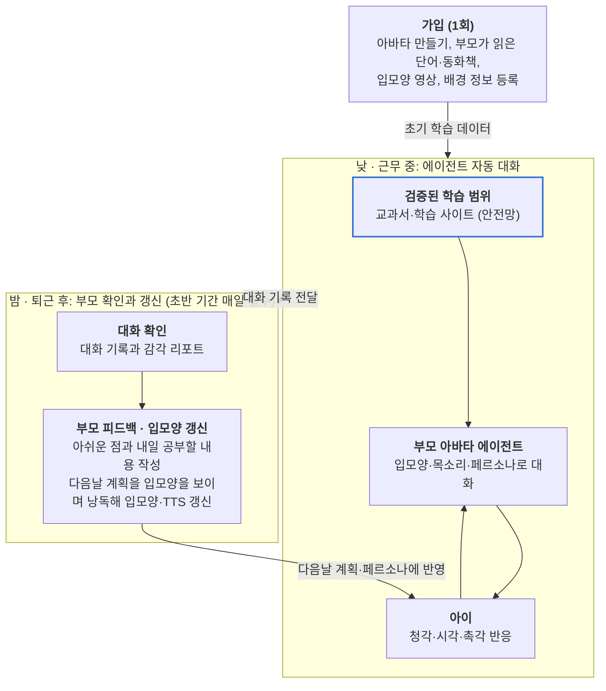

# 아이봄(Ai-Bom) / 마마보이스(MamaVoice)

> 부모의 페르소나를 담은 아바타로 아이의 감각과 언어를 깨우는 AI 에이전트

---

## 1. 추진 배경 및 문제 정의

1. **물리적 분리로 인한 소통의 제약**: 맞벌이 부모는 근무 중 실시간 전화나 영상통화가 어렵습니다. 말문이 트이고 태블릿을 접하는 2~5세 아이는 미디어에 의존하는 시간이 길어지고, 부모의 음성·입모양·표정을 접할 기회는 줄어듭니다.
2. **전문 지식의 부재**: 일반적인 부모는 발달심리·감각통합 지식이 부족해, 아이의 발달과 자아 형성에 필요한 교육을 제공하기 어렵습니다.
3. **일방향적 미디어 노출**: 기존 키즈 콘텐츠는 개별 발달 속도를 고려하지 않고 일방적으로 자극을 전달합니다. 아이가 따라가지 못하거나 특정 감각만 편중되게 발달할 위험이 있습니다.
4. **개인화된 교감 수단의 부족**: 목소리만 담는 앱은 이미 많지만, 부모의 고유한 말투와 성향, 가족이 공유한 경험까지 반영하지는 못합니다. AI와의 활동이 실제 부모와의 교감으로 이어지도록 돕는 기능도 제한적입니다.
5. **검증되지 않은 AI 대화의 위험**: 영유아와 자유롭게 대화하는 AI는 부적절하거나 부정확한 내용을 말할 수 있습니다. 아이는 그 내용을 가려낼 수 없습니다.

## 프로젝트 목표

1. **정서적 연속성 확보**: 부모가 일하는 동안에도 부모의 입모양·음성·억양·성향이 담긴 아바타로 아이에게 안정감을 줍니다.
2. **안전한 초개인화 감각·언어 학습**: 아이의 일과 중 반응(음성, 터치, 표정)과 부모 피드백을 바탕으로, 검증된 범위 안에서 청각·시각·촉각을 고르게 쓰는 학습·놀이를 제공합니다.
3. **부모의 육아 역량 동반 성장**: 매일 저녁 계획 낭독으로 입모양을 트래킹하고, 아이와 대화할 때의 발성·입모양·대화법을 코칭합니다.

## 타겟 유저

| 구분 | 대상 | 역할 |
|---|---|---|
| 핵심 타겟 | 근무 시간 동안 아이와의 단절에 죄책감을 느끼고, 아이의 언어·감각 발달에 관심이 많은 맞벌이 부모 | 가입 시 아바타와 학습 데이터 등록, 퇴근 후 대화 확인·피드백·계획 낭독 |
| 실사용자 | 태블릿을 조작할 수 있고 기본적인 의사표현을 시작하는 영유아(24~60개월) | 일과 중 에이전트와 대화·놀이 |

---

## 1-1. 감각 설계

이번 해커톤 주제인 '감각'을 서비스의 중심에 둡니다. 아이는 듣고, 입모양을 보고, 손으로 만지며 배우고, 에이전트는 아이가 어떤 감각에 반응했는지 읽어 다음 활동을 바꿉니다.

| 감각 | 태블릿이 주는 자극 | 에이전트가 읽는 반응 | 다음 활동 반영 |
|---|---|---|---|
| 시각 | 사물 이미지, 아바타의 입모양과 표정, 동작에 따른 화면 변화 | 화면 응시 시간, 입모양 모방, 표정 변화 | 입모양을 크게 보여주는 활동 비중 조절 |
| 청각 | 부모 목소리의 단어·동화·노래, 동작에 따른 소리 반응 | 웃음, 옹알이, 따라 말하기 | 말 속도와 재생 템포 조절 |
| 촉각 | 손가락 동작에 따른 진동, 눈으로 보이는 터치 반응 | 터치 빈도, 강도, 반응 속도 | 손을 쓰는 놀이 비중 조절 |

부모 리포트는 세 감각의 활동 균형을 보여주어 특정 감각으로 치우치지 않게 합니다. 미각과 후각은 태블릿으로 다룰 수 없어 범위에서 뺍니다. 감각 원인 해석과 식단 조언은 이전 회의 결정대로 넣지 않습니다.

### 세 감각을 한 동작에 묶는 방식

감각을 따로 주지 않고, 아이의 한 동작에 세 감각을 동시에 돌려줍니다. 아이는 보고 듣기만 하는 것이 아니라 손으로 해보면서 배웁니다.

**예: 사과 자르기**

| 단계 | 일어나는 일 |
|---|---|
| 1. 아바타가 권함 | 엄마 아바타가 입모양을 보이며 "지호야, 사과 같이 잘라볼까?" (시각 + 청각) |
| 2. 화면에 사과가 뜨기 | 사과 이미지가 화면 가운데 나타남 (시각) |
| 3. 아이가 손가락으로 그음 | 자르는 순간 짧은 진동이 울림 (촉각) |
| 4. 사과가 갈라짐 | 잘라지는 효과음과 함께 단면이 보임 (청각 + 시각) |
| 5. 이름을 들려줌 | 엄마 목소리로 "사과", 이어서 "Apple" (청각) |
| 6. 따라 말하기 | 아바타가 입모양을 크게 보이며 기다림 (시각) |
| 7. 아이가 따라 말함 | 사과가 톡 튀는 애니메이션과 짧은 진동으로 칭찬 (시각 + 촉각) |

이 한 바퀴가 끝나면 에이전트는 아이가 어느 단계에서 더 반응했는지 기록합니다. 동작에 반응이 좋았으면 자르고 넣는 놀이를 늘리고, 따라 말하기가 잘 되었으면 단어를 늘립니다.

### 다른 활동에 쓰는 동작

| 동작 | 촉각 | 청각 | 시각 |
|---|---|---|---|
| 자르기 (사과, 빵) | 자르는 순간 짧은 진동 | 잘라지는 소리, 이름 발음 | 단면이 보임 |
| 두드리기 (북, 문) | 세기에 따라 다른 진동 | 세기에 따라 다른 소리 | 파동이 퍼짐 |
| 끌어서 옮기기 (정리) | 제자리에 들어갈 때 짧은 진동 | "잘했어!" 부모 목소리 | 제자리에 맞춰짐 |
| 쓸어내기 (창문 성에) | 손가락을 따라오는 진동 | 쓸리는 소리 | 가려졌던 그림이 드러남 |

진동은 짧고 약하게만 씁니다. 길거나 강한 진동은 영유아가 놀랄 수 있어 안전망의 감각 자극 제한에 포함합니다. 진동을 끄는 설정도 둡니다.

### 아바타가 단어를 말할 때의 연출

아바타가 단어를 말하면 그 사물이 옆에 떨어지고, 아이가 누르면 그 사물다운 소리와 진동이 납니다. 사물마다 반응이 달라서 아이가 직접 누르는 재미로 이어집니다.

| 단어 | 등장 | 누르면 | 소리 | 진동 |
|---|---|---|---|---|
| 사과 | 화면 옆에 툭 떨어짐 | 한 입 베어 물린 자국 | 와그작 | 깨물리는 순간 짧게 |
| 바나나 | 화면 옆에 툭 떨어짐 | 껍질이 한 줄씩 벗겨짐 | 껍질 벗기는 소리 | 껍질이 벗겨지는 동안 약하게 |
| 물 | 컵에 차오름 | 흔들리며 출렁 | 꿀렁꿀렁 | 출렁일 때 짧게 |
| 북 | 통통 뛰며 등장 | 가운데가 움푹 들어감 | 둥·둥 (세기별) | 세게 치면 조금 더 |

한 번 누를 때마다 아바타가 그 이름을 부모 목소리로 다시 말해주고, 영어 노출을 고른 집은 한국어 뒤에 영어 이름이 붙습니다. 아이가 몇 번 눌렀는지, 어떤 사물에 오래 머물렀는지는 그대로 촉각·시각 반응 기록이 됩니다.

---

## 2-1. 전체 흐름도

> 낮에는 아바타가 감각 대화를 하고, 밤에는 부모가 피드백과 입모양으로 다음날을 갱신합니다.

부모는 낮에는 개입하지 않고, 밤의 피드백과 입모양 갱신으로 다음날 대화를 바꿉니다. 초반 기간에는 밤 과정이 매일 필수입니다.

### 2-1-1. 가입과 페르소나 생성

부모는 가입할 때만 초기 학습 데이터를 넣고, 이후 일과 중에는 따로 입력하지 않습니다.

1. **배경 정보 입력**: 아이 이름·생년월·말하기 수준·좋아하는 것, 부모 호칭·말투·희망 교육 방향(영어 노출 등). 아이 건강 정보는 받지 않습니다.
2. **아바타 만들기**: 인스타그램 아바타처럼 부모가 직접 골라 자신의 아바타를 만듭니다.
3. **부모 음성 등록**: '사과' 같은 단어와 동화책 내용을 엄마 목소리로 읽습니다. 화면의 학습률 게이지가 차오르는 것을 보며 어느 정도 더 해야 하는지 알 수 있습니다.
4. **입모양 영상 등록**: 문장을 읽는 정면 영상으로 입모양 기준값을 만들고, 이 입모양을 아바타에 반영합니다. 여기도 학습률을 함께 표시합니다. 표정 샘플은 선택입니다.
5. **AI 특성 분석**: 발화 간격, 톤 변화 등 부모의 말하기 특성을 분석합니다. (예: 발화 간격이 비교적 짧음, 톤이 일정함)
6. **의사소통 피드백**: 분석 결과를 부모에게 알려줍니다. (예: "아이가 대답할 수 있도록 질문 후 기다리는 시간을 늘려볼까요?")
7. **페르소나 확정**: 아바타, 입모양, 목소리, 말투, 성향을 합친 초안을 부모가 확인·수정한 뒤 최종 생성합니다. 이 확인은 가입 때 1회만 하며, 매 대화 승인은 없습니다.

#### 학습률 표시

지문 등록처럼, 부모가 지금 어느 정도 등록했는지 화면에 게이지로 보여줍니다. 말로만 "충분히 읽어주세요"라고 하면 언제 끝나는지 알 수 없어 중도에 그만둡니다.

| 항목 | 표시 방식 |
|---|---|
| 전체 학습률 | 0~100% 게이지. 최소 사용 기준선을 게이지 위에 표시 |
| 남은 양 | "지금까지 00문장 · 00문장 더 읽으면 쓸 수 있어요" |
| 음성 품질 | 조용한 곳인지, 목소리가 일정한지 문장별 확인 표시 |
| 입모양 인식 | 얼굴이 제대로 잡혔는지 촬영 중 표시 |
| 갱신 현황 | 퇴근 후 낭독마다 게이지가 올라감. 어느 정도까지 매일 필요한지 함께 표시 |

기준선에 닿기 전에도 서비스를 쓸 수는 있지만, 아바타 목소리가 어색할 수 있다고 알려줍니다. 게이지의 정확한 기준은 TTS 담당 팀원이 필요한 수량을 정한 뒤 채웁니다.

### 2-1-2. 기본 대화와 AI 안전망

부모 승인을 없앤 대신, 모든 일과 중 대화는 검증된 학습 범위 안에서만 생성합니다.

#### 대화 순서

1. 에이전트가 오늘의 학습 계획에서 주제와 감각 활동을 골라 질문합니다.
2. 아이의 음성을 STT로 인식합니다.
3. 검증된 학습 자료에서 관련 내용을 찾습니다.
4. LLM이 찾은 자료 범위 안에서 응답을 생성합니다.
5. 출력 전 안전 검사를 거칩니다.
6. 부모 아바타가 TTS와 입모양으로 말하고, 필요하면 화면 동작·효과음·진동을 함께 제시합니다.
7. 아이의 다음 응답과 동작을 기다리고, 대화를 반복합니다.
8. 대화 전체를 기록해 퇴근 후 부모에게 보여줍니다.

#### AI 안전망

| 장치 | 동작 |
|---|---|
| 학습 범위 제한 | 교과서와 아이 학습 사이트의 검증된 자료만 대화 근거로 사용 |
| 연령 맞춤 | 아이 연령·말하기 수준에 맞는 범위만 사용 |
| 감각 자극 제한 | 소리 크기, 화면 밝기, 화면 변화 속도, 진동 세기와 길이를 영유아에게 맞게 유지 |
| 범위 밖 질문 처리 | 답을 지어내지 않고 학습 주제로 되돌린 뒤, 부모 확인 목록에 표시 |
| 출력 전 검사 | 생성한 문장이 근거 자료와 맞지 않거나 부적절하면 출력하지 않음 |
| 사후 검토 | 부모가 퇴근 후 대화 전체를 확인하고 피드백 |

---

## 2-2. 4대 입출력 상세

부모의 입력은 가입과 퇴근 후에 모이고, 일과 중 아이 출력은 에이전트가 맡습니다.

### ① 부모의 투입 (부모 → 에이전트)

- **가입 시 배경 정보**: 부모 성향·선호, 희망 교육 방향(영어 노출 등), 아이 정보.
- **가입 시 아바타**: 부모가 직접 골라 만든 아바타.
- **가입 시 초기 학습 데이터**: 부모가 읽은 단어('사과')와 동화책 내용, 입모양 영상, 표정 샘플(선택).
- **퇴근 후 피드백**: 대화에서 아니다 싶은 부분과 다음날 공부할 내용을 적습니다. (예: "이 말투는 우리 아이에게 너무 빠르다", "내일은 동물 이름을 공부하면 좋겠다")
- **퇴근 후 입모양 갱신**: 다음날 계획을 부모가 입모양을 보이며 직접 읽어 입모양과 TTS 정확도를 갱신합니다. 번거로운 과정이지만 초반 기간에는 매일 필수입니다.
- **오늘의 기록**: 좋아한 사물(초록 공룡), 부모가 가르쳐준 단어. 싫어하는 것, 건강 정보, 부모와 아이의 실제 대화는 기록하지 않습니다.

> 비고: 입모양 분석은 Python 라이브러리를 사용하며 조장님이 맡을 수 있습니다. 표정 샘플은 구현이 어려울 수 있습니다.

### ② 아이의 투입 (아이·태블릿 → 에이전트)

- **청각·언어 반응(필수)**: 신난 목소리, 웃음소리, 울음, 옹알이, 따라 말하는 음성. 발화 내용을 인식해 대화를 생성합니다.
- **촉각 반응**: 화면을 치는 빈도, 터치 강도, 반응 속도.
- **시각 반응**: 화면을 바라보는 집중 시간, 입모양 모방 여부, 표정 변화.

### ③ 에이전트의 부모 출력 (에이전트 → 부모 앱)

- **대화 기록**: 일과 중 에이전트와 아이가 나눈 대화 전체. 퇴근 후 확인합니다.
- **확인 필요 목록**: 에이전트가 범위 밖이라고 판단한 질문과 장면.
- **발달·감각 리포트**: 오늘의 학습 주제, 따라 말한 단어, 집중도, 청각·시각·촉각 활동 균형.
- **다음날 계획 낭독 대본**: 피드백을 반영한 다음날 계획. 부모가 입모양을 보이며 읽고, 학습률 게이지가 올라갑니다.
- **부모 코칭**: 낭독에서 트래킹한 입모양을 반영합니다. (예: "목소리 톤을 조금 높이고, 입모양을 20% 더 크게 벌려 말해주세요.")
- **언어 연계 팁**: (예: "한국어로 '사과'를 완벽히 인지했으니, 이제 영어 'Apple'을 노출할 타이밍입니다.")

> 비고: TTS는 다른 팀원이 부모 목소리 데이터를 바탕으로 구현합니다.

### ④ 아이 출력 (에이전트·부모 → 아이)

#### 모듈 1: 일과 중 에이전트 자동 대화 (태블릿)

에이전트가 검증된 학습 범위 안에서 스스로 대화와 학습을 이끕니다.

- 전날 부모가 읽은 다음날 계획을 바탕으로 그날의 학습을 진행합니다.
- 부모 아바타가 부모의 목소리·입모양·말투로 말하고, 아이 속도에 맞춰 템포를 조절합니다.
- 듣기, 입모양 따라 하기, 만져보기를 번갈아 써 청각·시각·촉각을 고르게 자극합니다.
- 부모가 영어를 못해도 부모 아바타가 영어 동화·노래를 들려줍니다. 아이는 "우리 엄마가 이런 것도 하네"라고 느낍니다.

#### 모듈 2: 퇴근 후 부모 직접 출력

- 코칭받은 부모가 목소리 톤과 입모양을 의식하며 아이에게 직접 말을 겁니다.
- 대화 기록에서 찾은 주제로 놀이합니다. (예: 초록 공룡 놀이)
- 이 실제 대화는 앱에 기록하지 않습니다.

---

## 3. 핵심 차별점

목소리만 담는 앱과 달리, 아이봄은 부모의 페르소나를 아바타에 담아 아이의 감각을 깨웁니다.

1. **목소리가 아닌 페르소나**: 부모가 만든 아바타에 엄마의 입모양, 말투, 성향까지 담습니다. 아이는 "우리 엄마가 이런 것도 하네"라는 놀라움을 느낍니다.
2. **감각을 고르게 쓰는 대화**: 아이가 사과를 자르는 동작 하나에 진동, 효과음, 'Apple' 발음이 한꺼번에 따라옵니다. 보기만 하는 콘텐츠와 달리 손으로 해보면서 배우고, 에이전트는 그 반응을 읽어 다음 활동을 바꿉니다.
3. **부모 사후 검토형(Parent-on-the-loop) 구조**: 근무 중 부모가 승인할 필요가 없습니다. 부모는 저녁 피드백과 낭독으로 방향을 정합니다.
4. **검증된 범위 안의 자율 대화**: 에이전트는 자율로 대화하지만, 검증된 학습 자료 밖의 내용은 말하지 않습니다.
5. **매일 정확해지는 페르소나(Dual-Loop)**:
   - 디지털 루프 (낮/근무 중): `아바타 자동 대화 → 아이의 감각 반응 → 에이전트 속도·활동 조절 → 대화 기록`
   - 부모 루프 (밤/퇴근 후): `대화 확인 → 피드백 → 다음날 계획 낭독 → 입모양·TTS 갱신`

### 시연 장면

1. **가입**: 부모가 아바타를 만들고 '사과'와 동화책 내용을 녹음합니다.
2. **낮**: 엄마 아바타가 "사과 같이 잘라볼까?"라고 묻고, 아이가 화면을 그으면 진동과 효과음이 울리며 "사과", "Apple"이 들립니다.
3. **범위 밖 질문**: 에이전트가 답을 지어내지 않고 학습 주제로 되돌아갑니다.
4. **밤**: 부모가 대화와 감각 리포트를 확인하고, 피드백을 적은 뒤 다음날 계획을 입모양을 보이며 읽습니다.
5. **다음날**: 아바타가 갱신된 입모양과 피드백을 반영한 주제로 대화를 시작합니다.

---

## 4. 기대 효과 및 리스크

가장 큰 리스크는 부모 승인 없이 부모 목소리로 자율 대화를 한다는 점입니다.

### 기대 효과

- **아이**: 부모와의 애착 형성 유지, 본인의 발달 속도에 맞춰 청각·시각·촉각을 고르게 쓰는 감각·언어 확장.
- **부모**: 육아 죄책감 해소, 근무 중 부담 없이 아이의 하루 파악, 입모양·발성 코칭을 통한 성장.

### 리스크와 해결 방안

| 리스크 | 해결 방안 |
|---|---|
| 자율 대화의 부적절한 내용 | 검증된 학습 범위 제한, 출력 전 검사, 퇴근 후 사후 검토 |
| 아이가 AI를 실제 부모로 오인 | 실제 얼굴이 아닌 아바타로 표현하고, "이따 엄마 오면 초록 공룡 이야기 해줄래?"처럼 실제 부모에게 연결 |
| 저녁 낭독의 부모 부담 | 낭독 분량을 짧게 유지하고, 초반 기간이 지나면 빈도를 줄임 |
| 감각 과자극과 편중 | 소리·밝기·화면 변화 제한, 리포트에 세 감각의 활동 균형 표시 |
| 아이 혼자 태블릿 사용 | 서비스는 돌봄을 대신하지 않으며, 아이 곁에 어른이 있는 환경을 전제로 함 |
| 과도한 스크린 타임 | 화면을 끄고 부모 목소리로만 대화하는 '청각 집중 모드' 배치 |
| 데이터 프라이버시 | 영유아 음성·영상, 부모 생체 데이터, 일과 중 대화 기록, 입모양 트래킹 데이터를 기기 내 처리하거나 최고 수준으로 암호화 |
| 부모와의 대면 괴리감 | 에이전트는 부모를 대체하지 않고 퇴근 후 상호작용을 돕는 가교 역할 |

---

## 5. 시연용 데이터

해커톤 기간에는 새로 만들지 않고 오픈소스 데이터로 결과물을 만듭니다.

| 종류 | 쓰는 곳 | 범위 |
|---|---|---|
| 사물 이미지 | 사과, 바나나 등 단어 연출 | 시연에 쓸 단어 몇 개만 |
| 동화책 | 부모 녹음과 읽어주기 활동 | 공유 저작물 한·두 권 |
| 효과음 | 와그작, 껍질 벗기는 소리 등 | 동작별로 몇 개 |
| 학습 범위 자료 | AI 안전망의 근거 자료 | 공개된 영유아 교육과정 문서 |

사용한 자료의 출처와 라이선스는 목록으로 정리해 둡니다. 상용 서비스로 가면 데이터를 다시 확보해야 합니다.

---

## 결정이 필요한 사항

이번 구조 변경으로 아래 사항을 새로 정해야 합니다. 추천안은 팀 합의 전 제안입니다.

| 쟁점 | 왜 문제인가 | 추천안 |
|---|---|---|
| 초반 기간과 낭독 분량 | 매일 필수 기간과 하루 분량이 정해지지 않음 | TTS 담당 팀원이 갱신에 필요한 수량을 정한 뒤 확정 |
| 아바타와 입모양 연결 | 부모 입모양이 아바타에 어느 수준까지 반영되는지 미확인 | 입모양 분석 담당자가 가능한 범위를 확인, 해커톤은 아바타 1종으로 시연 |
| 검증 범위의 기준 | 24~60개월은 교과서 대상 연령이 아님 | 누리과정과 표준보육과정을 기준 후보로 검토(자료 조사 전), 해커톤은 소수 주제만 구현 |
| 학습 자료 이용 권한 | 교과서·사이트·동화책 내용은 저작권 확인 필요 (5장 참고) | 시연에는 이용 가능한 자료만 사용 |
| 긴급 상황 처리 | 부모가 퇴근 후에만 보면 아이의 "아파", 지속된 울음을 늦게 알게 됨 | 퇴근 후 확인을 원칙으로 두고, 위험 신호일 때만 근무 중 알림 |
| 자율 대화의 시작과 상한 | 에이전트가 스스로 시작하면 사용 시간이 길어질 수 있음 | 가입 시 시간대와 하루 상한을 부모가 설정 |
| 초기 학습 데이터의 양 | 녹음 몇 개로 자유 대화 TTS가 가능한지 미확인 | TTS 담당 팀원이 필요한 수량을 확정 |
| 진동 지원 기기 | 태블릿에 따라 진동이 없거나 세기 조절이 안 됨 | 진동은 보조 자극으로 두고, 없으면 효과음과 화면 변화로 대체 |
