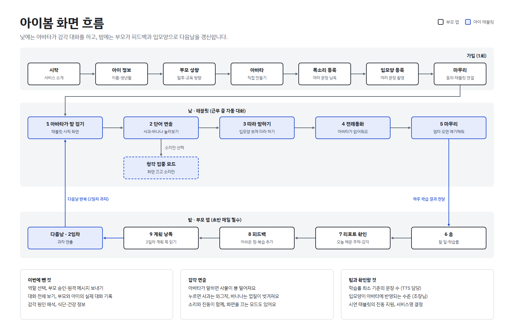
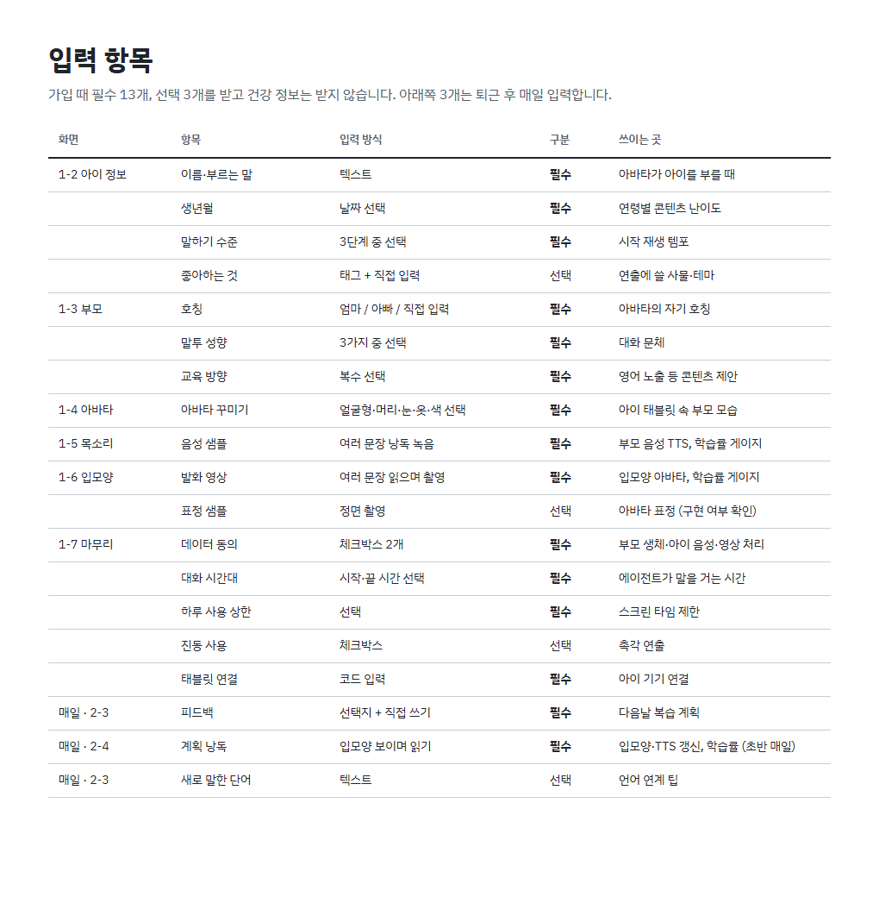

# 아이봄 와이어프레임

원본(인터랙티브 캔버스): https://claude.ai/artifact/EAjyiqT3qMtp8QEs61wGUf
화면 21장 = 흐름도 1 + 입력 항목표 1 + 온보딩 7 + 부모 앱 4 + 아이 태블릿 8. 앱 화면 디테일은 이 문서와 원본 캔버스를 따른다.

> 아래 문장·퍼센트·수치는 모두 **예시/임시**다. 오픈소스 동화·그림은 시연용 (출처는 `docs/data-sources.md`에 기록).

## 1. 온보딩 (부모 앱, 7단계)

| # | 화면 | 내용 | 메모 |
|---|---|---|---|
| 1-1 | 시작 | 앱 소개, "시작하기" | 역할 선택 없이 부모만 가입 |
| 1-2 | 아이 정보 | 이름·부르는 말, 생년월, 말하기 수준(한 단어/두 단어/짧은 문장), 좋아하는 것(선택) | 생년월→콘텐츠 난이도, 말하기 수준→시작 템포. 건강 정보는 받지 않음 |
| 1-3 | 부모 성향·교육 방향 | 호칭(엄마/아빠/직접), 말투(다정한/장난스러운/차분한), 바라는 방향(복수) | 호칭·말투→대화 문체, 방향→콘텐츠 제안 |
| 1-4 | 아바타 만들기 | 얼굴형·머리·눈·옷·색 선택 + 미리보기 | 선택지 종류·개수는 입모양 구현 범위 확정 후 결정 |
| 1-5 | 목소리 등록 | 문장 낭독 녹음, 원형 학습률 게이지(최소 기준 눈금) | 녹음 버튼 → 다음 문장 + 학습률 상승. 기준 문장 수는 TTS 담당이 정함 |
| 1-6 | 입모양 등록 | 문장을 읽으며 촬영, 학습률 게이지 | 아바타 반영 수준은 팀장과 확인 필요. 표정 샘플은 "나중에" |
| 1-7 | 동의·설정·연결 | 데이터 동의 2개, 대화 시간대, 하루 사용 상한, 진동 사용, 태블릿 연결 코드 | 시간대·상한은 가입 때 부모가 정함 |

## 2. 부모 앱 (밤, 하단 탭 4개: 홈 · 리포트 · 피드백 · 내일 계획)

| # | 화면 | 내용 |
|---|---|---|
| 2-1 | 홈 | "오늘 밤 할 일"(리포트 → 피드백 → 내일 계획), 오늘·내일 주제, 확인 필요 건수, 음성·입모양 원형 학습률. 승인 화면 없음 |
| 2-2 | 리포트 | 대화 기록 대신 요약. 맨 위 "오늘은 이 주제를 배웠어요", 확인 필요 건(범위 밖 질문 등)은 아래 |
| 2-3 | 피드백 | 아쉬운 점 선택지(말이 빨라요/질문이 어려워요/진동이 세요/목소리가 어색해요)+직접 쓰기, 내일 주제 표시, 복습 추가(선택), 오늘 새로 말한 단어(선택) |
| 2-4 | 내일 계획 낭독 | 내일 계획(2일차 과자)을 입모양을 보이며 읽기. 읽은 만큼 학습률 상승. "낭독 완료" → 다음날 3-5 |

- 커리큘럼은 하나로 고정. 내일 주제는 고르지 않고 보여주기만 하며 복습만 추가할 수 있다.

## 3. 아이 태블릿 (글자 최소, 아바타가 먼저 말 걸기)

| # | 화면 | 내용 | 연출(소리/진동) |
|---|---|---|---|
| 3-1 | 아바타가 말 걸기 | 큰 버튼 하나로 시작 | |
| 3-2 | 사과 | 사과를 누르면 베어 문 모양 | 와그작 소리, 베어 무는 순간 짧은 진동 |
| 3-3 | 바나나 | 누르면 껍질이 한 줄씩 벗겨짐 | 껍질 소리, 벗겨지는 동안 약한 진동 |
| 3-4 | 따라 말하기 | 마이크를 누르면 사과가 톡 튐. 틀렸다는 표시 없음 | 짧은 진동 |
| 3-5 | 과자 (2일차) | 누르면 과자가 부러짐 | 바삭 소리, 부러지는 순간 짧은 진동 |
| 3-6 | 전래동화 | 아바타가 읽어주고 장면 그림이 넘어감 | |
| 3-7 | 청각 집중 모드 | 화면을 끄고 부모 목소리로만 대화 (스크린 타임 대응) | |
| 3-8 | 마무리 | 실제 부모에게 연결 (AI가 부모를 대체하지 않도록) | |

## 4. 입력 항목 (가입 필수 13 · 선택 3 · 매일 3)

| 화면 | 항목 | 입력 방식 | 구분 | 쓰이는 곳 |
|---|---|---|---|---|
| 1-2 | 이름·부르는 말 | 텍스트 | 필수 | 아바타가 아이를 부를 때 |
| 1-2 | 생년월 | 날짜 선택 | 필수 | 연령별 콘텐츠 난이도 |
| 1-2 | 말하기 수준 | 3단계 선택 | 필수 | 시작 재생 템포 |
| 1-2 | 좋아하는 것 | 태그 + 직접 입력 | 선택 | 연출에 쓸 사물·테마 |
| 1-3 | 호칭 | 엄마/아빠/직접 입력 | 필수 | 아바타의 자기 호칭 |
| 1-3 | 말투 성향 | 3가지 중 선택 | 필수 | 대화 문체 |
| 1-3 | 교육 방향 | 복수 선택 | 필수 | 영어 노출 등 콘텐츠 제안 |
| 1-4 | 아바타 꾸미기 | 얼굴형·머리·눈·옷·색 | 필수 | 아이 태블릿 속 부모 모습 |
| 1-5 | 음성 샘플 | 여러 문장 낭독 녹음 | 필수 | 부모 음성 TTS, 학습률 |
| 1-6 | 발화 영상 | 여러 문장 읽으며 촬영 | 필수 | 입모양 아바타, 학습률 |
| 1-6 | 표정 샘플 | 정면 촬영 | 선택 | 아바타 표정 (구현 여부 확인) |
| 1-7 | 데이터 동의 | 체크박스 2개 | 필수 | 부모 생체·아이 음성·영상 처리 |
| 1-7 | 대화 시간대 | 시작·끝 시간 | 필수 | 에이전트가 말을 거는 시간 |
| 1-7 | 하루 사용 상한 | 선택 | 필수 | 스크린 타임 제한 |
| 1-7 | 진동 사용 | 체크박스 | 선택 | 촉각 연출 |
| 1-7 | 태블릿 연결 | 코드 입력 | 필수 | 아이 기기 연결 |
| 매일 2-3 | 피드백 | 선택지 + 직접 쓰기 | 필수 | 다음날 복습 계획 |
| 매일 2-4 | 계획 낭독 | 입모양 보이며 읽기 | 필수 | 입모양·TTS 갱신, 학습률 (초반 매일) |
| 매일 2-3 | 새로 말한 단어 | 텍스트 | 선택 | 언어 연계 팁 |

## 5. 화면 이미지

`docs/wireframe/` 폴더의 PNG (원본 캔버스를 같은 해상도로 캡처, 입력창 등은 기본 상태).

- 흐름도:  · 입력 항목표: 
- 온보딩: `1-1-start` `1-2-child` `1-3-parent` `1-4-avatar` `1-5-voice` `1-6-mouth` `1-7-setup`
- 부모 앱: `2-1-home` `2-2-report` `2-3-feedback` `2-4-plan-read`
- 아이 태블릿: `3-1-start` `3-2-apple` `3-3-banana` `3-4-repeat` `3-5-snack` `3-6-story` `3-7-audio` `3-8-end`
