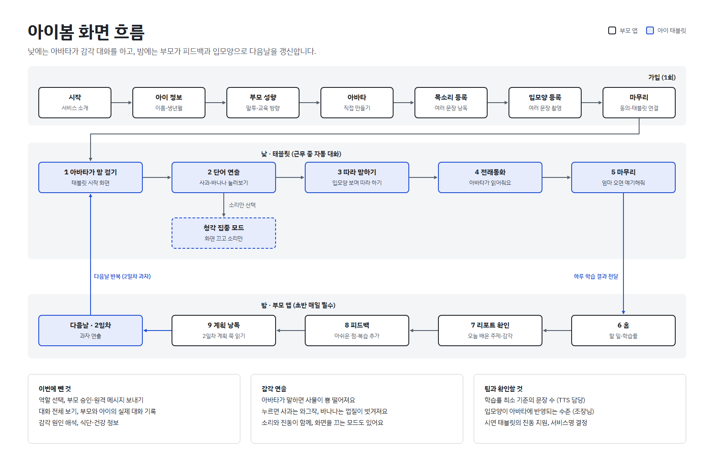

# 아이맘 기획서 v2

2026-10-31

일과 중에는 에이전트가 검증된 학습 범위 안에서 부모의 페르소나를 담은 아바타로 아이의 청각·시각·촉각을 깨우는 대화를 합니다. 부모는 퇴근 후 그날의 리포트를 확인해 피드백을 남기고, 정해진 다음날 계획을 입모양을 보이며 읽어 갱신합니다.

## 이번 수정 요약

서비스 구조가 '부모가 승인해서 보내는 방식'에서 '에이전트가 자율로 대화하고 부모가 저녁에 확인하는 방식'으로 바뀝니다.

| 항목 | 이전 | 수정 후 |
| --- | --- | --- |
| 사용자 | 부모, 아이, 보조 사용자 | 부모와 아이 둘뿐 |
| 일과 중 대화 | 부모가 입력하거나 승인한 콘텐츠만 재생 | 에이전트가 스스로 대화 시작 |
| 부모 개입 시점 | 근무 중 실시간 | 퇴근 후에만 |
| 부모 입력 | 원격 메시지, 테마 선택, 일일 기록 | 가입 시 아바타·초기 학습 데이터, 저녁 피드백·계획 낭독 |
| 학습 데이터 | 음성·입모양 샘플 | 부모 음성으로 읽은 단어·동화책 내용 추가 |
| 부모 표현 | 부모 음성과 입모양 영상 | 부모가 직접 만든 아바타에 입모양과 페르소나 반영 |
| 입모양 분석 | 가입 시 1회 | 매일 저녁 다음날 계획을 읽으며 갱신 |
| 퇴근 후 과정 | 코칭을 받고 육아 기록 입력 | 리포트 확인, 피드백, 계획 낭독 (실제 대화는 기록 안 함) |
| 대화 범위 | 별도 제한 없음 | 검증된 학습 범위 안으로 제한 (AI 안전망) |
| 해커톤 주제 | 감각은 목표 중 하나 | 청각·시각·촉각 설계를 서비스 중심에 배치 |
| 퇴근 후 확인 | 대화 기록 확인 | 오늘의 리포트 ("오늘은 사과와 바나나를 배웠어요") |
| 학습 주제 | 부모가 계획 선택·입력 | 하나의 커리큘럼을 순서대로 (내일 2일차는 과자) |
| 기기 관리 | 기기 역할을 한 번 정하면 바꿀 수 없음 | 부모 앱 설정 탭에서 연결 키 재발급·기기 해제·모드 전환, 아이 태블릿은 어른용 숨은 메뉴로 전환 |
| 로그인 | 없음 (기기에만 저장) | 가입 마지막에 부모 계정(아이디·비밀번호)을 만들고, 다른 폰·재설치 때 로그인으로 같은 가족 정보를 불러옴 |
| 서비스 이름 | 아이봄 / 마마보이스 | 아이맘 (ai-mom) |

### 팀 피드백 반영표

이번 피드백의 중심은 아이가 학습하는 화면입니다. 설정, 계정, 학습 기록은 그 화면을 믿고 쓰게 받쳐주는 일입니다.

| 피드백 | 바꾼 내용 | 위치 |
| --- | --- | --- |
| 학습 화면의 효과가 약함 | 사과가 통통 튀며 등장하고, 터치와 말소리에 반응하는 움직임을 단계별로 정의 | 2-3 |
| 아바타가 아이에게 친근하지 않음 | 둥근 캐릭터, 표정 5종, 아이 행동에 반응하는 아바타 | 2-3 |
| 색감이 차가움 | 노랑·연두 중심의 색 기준 | 2-3 |
| 얼굴이 인식되는 느낌이 없음 | 실제 인식값을 틀 색, 입 윤곽선, 학습률 링으로 표시 | 2-4 |
| 앱 정보가 정리되지 않고 설정 위치가 불편함 | 화면마다 맨 위 정보를 하나로 정하고 설정 탭을 고정 | 2-5 |
| 아바타를 못 바꾸고, 연결 코드가 가입 때만 보임 | 설정 탭에서 아바타 변경과 연결 코드 확인 | 2-5 |
| 한 기기로 쓸 수 없음 | 아이 모드와 부모 모드 전환 | 2-5 |
| 로그인, 아이디 만들기, 백엔드가 없음 | 실제 동작하는 계정 기능과 API, 데이터 구조 | 2-6 |
| 안 배웠는데 배웠다고 나옴 | 활동 기록으로만 '만났어요', '배웠어요'를 판정 | 2-7 |
| 일차에 따라 문장이 안 바뀜 | 서버의 현재 일차 값 하나로 모든 화면 문장을 생성 | 2-7 |

## 1. 프로젝트 헌장

### 서비스 정의

맞벌이 부부와 아이의 정서적 연결을 유지하고, 아이의 감각·언어 발달을 맞춤형으로 돕는 **AI 육아 파트너 에이전트**입니다. 부모가 직접 만든 아바타에 부모의 입모양·목소리·말투·성향을 담은 AI 페르소나가, 검증된 학습 범위 안에서 청각·시각·촉각을 함께 쓰는 대화와 놀이를 제공합니다. 퇴근 후 부모는 오늘의 리포트를 확인해 피드백을 남기고, 정해진 다음날 계획을 읽으며 페르소나를 갱신합니다.

### 프로젝트명 (가칭)

**아이맘(ai-mom):** 부모의 페르소나를 담은 아바타로 아이의 감각과 언어를 깨우는 AI 에이전트

### 추진 배경 및 문제 정의

- **물리적 분리로 인한 소통의 제약:** 맞벌이 부모는 근무 중 실시간 전화나 영상통화가 어렵습니다. 말문이 트이고 태블릿을 접하는 2~5세 아이는 미디어에 의존하는 시간이 길어지고, 부모의 음성·입모양·표정을 접할 기회는 줄어듭니다.
- **전문 지식의 부재:** 일반적인 부모는 발달심리·감각통합 지식이 부족해, 아이의 발달과 자아 형성에 필요한 교육을 제공하기 어렵습니다.
- **일방향적 미디어 노출:** 기존 키즈 콘텐츠는 개별 발달 속도를 고려하지 않고 일방적으로 자극을 전달합니다. 아이가 따라가지 못하거나 특정 감각만 편중되게 발달할 위험이 있습니다.
- **개인화된 교감 수단의 부족:** 목소리만 담는 앱은 이미 많지만, 부모의 고유한 말투와 성향, 가족이 공유한 경험까지 반영하지는 못합니다. AI와의 활동이 실제 부모와의 교감으로 이어지도록 돕는 기능도 제한적입니다.
- **검증되지 않은 AI 대화의 위험:** 영유아와 자유롭게 대화하는 AI는 부적절하거나 부정확한 내용을 말할 수 있습니다. 아이는 그 내용을 가려낼 수 없습니다.

### 프로젝트 목표

1. **정서적 연속성 확보:** 부모가 일하는 동안에도 부모의 입모양·음성·억양·성향이 담긴 아바타로 아이에게 안정감을 줍니다.
2. **안전한 초개인화 감각·언어 학습:** 아이의 일과 중 반응(음성, 터치, 표정)과 부모 피드백을 바탕으로, 검증된 범위 안에서 청각·시각·촉각을 고르게 쓰는 학습·놀이를 제공합니다.
3. **부모의 육아 역량 동반 성장:** 매일 저녁 계획 낭독으로 입모양을 트래킹하고, 아이와 대화할 때의 발성·입모양·대화법을 코칭합니다.

### 타겟 유저

| 구분 | 대상 | 역할 |
| --- | --- | --- |
| 핵심 타겟 | 근무 시간 동안 아이와의 단절에 죄책감을 느끼고, 아이의 언어·감각 발달에 관심이 많은 맞벌이 부모 | 가입 시 아바타와 학습 데이터 등록, 퇴근 후 리포트 확인·피드백·계획 낭독 |
| 실사용자 | 태블릿을 조작할 수 있고 기본적인 의사표현을 시작하는 영유아(24~60개월) | 일과 중 에이전트와 대화·놀이 |

## 1-1. 감각 설계

이번 해커톤 주제인 '감각'을 서비스의 중심에 둡니다. 아이는 듣고, 입모양을 보고, 손으로 만지며 배우고, 에이전트는 아이가 어떤 감각에 반응했는지 읽어 다음 활동을 바꿉니다.

| 감각 | 태블릿이 주는 자극 | 에이전트가 읽는 반응 | 다음 활동 반영 |
| --- | --- | --- | --- |
| 시각 | 사물 이미지, 아바타의 입모양과 표정, 동작에 따른 화면 변화 | 화면 응시 시간, 입모양 모방, 표정 변화 | 입모양을 크게 보여주는 활동 비중 조절 |
| 청각 | 부모 목소리의 단어·동화·노래, 동작에 따른 소리 반응 | 웃음, 옹알이, 따라 말하기 | 말 속도와 재생 템포 조절 |
| 촉각 | 손가락 동작에 따른 진동, 눈으로 보이는 터치 반응 | 터치 빈도, 강도, 반응 속도 | 손을 쓰는 놀이 비중 조절 |

부모 리포트는 세 감각의 활동 균형을 보여주어 특정 감각으로 치우치지 않게 합니다. 미각과 후각은 태블릿으로 다룰 수 없어 범위에서 뺍니다. 감각 원인 해석과 식단 조언은 이전 회의 결정대로 넣지 않습니다.

### 세 감각을 한 동작에 묶는 방식

감각을 따로 주지 않고, 아이의 한 동작에 세 감각을 동시에 돌려줍니다. 아이는 보고 듣기만 하는 것이 아니라 손으로 해보면서 배웁니다.

**예: 사과 와그작 먹기**

| 단계 | 일어나는 일 |
| --- | --- |
| 1. 아바타가 말함 | 엄마 아바타가 입모양을 보이며 "사과!" (시각 + 청각) |
| 2. 사과가 뿅 떨어짐 | 사과 이미지가 화면에 떨어지듯 나타남 (시각) |
| 3. 아이가 사과를 누름 | 한 입 베어 문 모양으로 바뀜 (시각) |
| 4. 와그작 | 와그작 소리와 함께 베어 무는 순간 짧게 진동 (청각 + 촉각) |
| 5. 이름을 들려줌 | 엄마 목소리로 "사과", 이어서 "Apple" (청각) |
| 6. 따라 말하기 | 아바타가 입모양을 크게 보이며 기다림 (시각) |
| 7. 아이가 따라 말함 | 사과가 톡 튀고 짧은 진동으로 칭찬 (시각 + 촉각) |

이 한 바퀴가 끝나면 에이전트는 아이가 어느 단계에서 더 반응했는지 기록합니다. 동작에 반응이 좋았으면 누르고 먹는 놀이를 늘리고, 따라 말하기가 잘 되었으면 단어를 늘립니다.

### 다른 활동에 쓰는 동작

| 동작 | 촉각 | 청각 | 시각 |
| --- | --- | --- | --- |
| 누르기 (사과 와그작, 바나나 껍질) | 베어 무는 순간 짧게, 껍질은 약하게 | 와그작·껍질 소리, 이름 발음 | 베어 문 모양, 껍질이 벗겨짐 |
| 두드리기 (북, 문) | 세기에 따라 다른 진동 | 세기에 따라 다른 소리 | 파동이 퍼짐 |
| 끌어서 옮기기 (정리) | 제자리에 들어갈 때 짧은 진동 | "잘했어!" 부모 목소리 | 제자리에 맞춰짐 |
| 쓸어내기 (그림 드러내기) | 손가락을 따라오는 진동 | 쓸리는 소리 | 가려졌던 그림이 드러남 |

진동은 짧고 약하게만 씁니다. 길거나 강한 진동은 영유아가 놀랄 수 있어 안전망의 감각 자극 제한에 포함합니다. 진동을 끄는 설정도 둡니다.

### 아바타가 단어를 말할 때의 연출

아바타가 단어를 말하면 그 사물이 옆에 떨어지고, 아이가 누르면 그 사물다운 소리와 진동이 납니다. 사물마다 반응이 달라서 아이가 직접 누르는 재미로 이어집니다.

| 단어 | 등장 | 누르면 | 소리 | 진동 |
| --- | --- | --- | --- | --- |
| 사과 | 화면 옆에 뿅 떨어짐 | 한 입 베어 물린 자국 | 와그작 | 깨물리는 순간 짧게 |
| 바나나 | 화면 옆에 뿅 떨어짐 | 껍질이 한 줄씩 까짐 | 껍질 벗기는 소리 | 껍질이 벗겨지는 동안 약하게 |
| 물 | 컵에 차오름 | 흔들리며 벌컥 | 꿀꺽꿀꺽 | 마실 때 짧게 |
| 북 | 통통 뛰며 등장 | 가운데가 움푹 들어감 | 둥·둥 (세기별) | 세게 치면 조금 더 |

한 번 누를 때마다 아바타가 그 이름을 부모 목소리로 다시 말해주고, 영어 노출을 고른 집은 한국어 뒤에 영어 이름이 붙습니다. 아이가 몇 번 눌렀는지, 어떤 사물에 오래 머물렀는지는 그대로 촉각·시각 반응 기록이 됩니다.

## 2-1. 전체 흐름도

부모는 낮에는 개입하지 않고, 밤의 피드백과 입모양 갱신으로 다음날 대화를 바꿉니다. 초반 기간에는 밤 과정이 매일 필수입니다.

## 2-1-1. 가입과 페르소나 생성

부모는 아이디를 만들어 로그인하고(2-6), 가입할 때만 초기 학습 데이터를 넣습니다. 이후 일과 중에는 따로 입력하지 않습니다. 가입 절차의 마지막에 아이 기기를 연결하며, 아바타와 연결 코드는 가입 뒤에도 설정에서 다시 볼 수 있습니다(2-5).

1. **배경 정보 입력:** 아이 이름·생년월·말하기 수준·좋아하는 것, 부모 호칭·말투·희망 교육 방향(영어 노출 등). 아이 건강 정보는 받지 않습니다.
2. **아바타 만들기:** 인스타그램 아바타처럼 부모가 직접 골라 자신의 아바타를 만듭니다.
3. **부모 음성 등록:** '사과' 같은 단어와 동화책 내용을 엄마 목소리로 읽습니다. 한 번 녹음으로는 부족해서 한 문장이 아니라 여러 문장을 차례로 띄워 읽게 하고, 한 문장을 읽을 때마다 학습률이 오릅니다. 화면의 원형 학습률이 차오르는 것을 보며 어느 정도 더 해야 하는지 알 수 있습니다.
4. **입모양 영상 등록:** 문장을 읽는 정면 영상으로 입모양 기준값을 만들고, 이 입모양을 아바타에 반영합니다. 여기도 여러 문장을 차례로 읽게 하고, 읽을 때마다 학습률이 오릅니다. 표정 샘플은 선택입니다.
5. **AI 특성 분석:** 발화 간격, 톤 변화 등 부모의 말하기 특성을 분석합니다. (예: 발화 간격이 비교적 짧음, 톤이 일정함)
6. **의사소통 피드백:** 분석 결과를 부모에게 알려줍니다. (예: "아이가 대답할 수 있도록 질문 후 기다리는 시간을 늘려볼까요?")
7. **페르소나 확정:** 아바타, 입모양, 목소리, 말투, 성향을 합친 초안을 부모가 확인·수정한 뒤 최종 생성합니다. 이 확인은 가입 때 1회만 하며, 매 대화 승인은 없습니다.

### 학습률 표시

지문 등록처럼, 부모가 지금 어느 정도 등록했는지 화면에 원형 링으로 보여줍니다. 말로만 "충분히 읽어주세요"라고 하면 언제 끝나는지 알 수 없어 중도에 그만둡니다. 녹음 한 번으로는 학습이 되지 않으므로, 여러 문장을 차례로 띄우고 한 문장을 읽을 때마다 원이 채워지게 합니다.

| 항목 | 표시 방식 |
| --- | --- |
| 전체 학습률 | 0~100% 원형 링. 최소 사용 기준을 링 위의 눈금과 '최소 기준' 글자로 표시 |
| 남은 양 | "지금까지 00문장 · 00문장 더 읽으면 쓸 수 있어요" |
| 음성 품질 | 조용한 곳인지, 목소리가 일정한지 문장별 확인 표시 |
| 입모양 인식 | 얼굴이 제대로 잡혔는지 촬영 중 표시 |
| 갱신 현황 | 퇴근 후 낭독마다 링이 채워짐. 어느 정도까지 매일 필요한지 함께 표시 |

기준선에 닿기 전에도 서비스를 쓸 수는 있지만, 아바타 목소리가 어색할 수 있다고 알려줍니다. 학습률의 정확한 기준은 TTS 담당 팀원이 필요한 수량을 정한 뒤 채웁니다.

## 2-1-2. 기본 대화와 AI 안전망

부모 승인을 없앤 대신, 모든 일과 중 대화는 검증된 학습 범위 안에서만 생성합니다.

### 대화 순서

1. 에이전트가 오늘의 학습 계획에서 주제와 감각 활동을 골라 질문합니다.
2. 아이의 음성을 STT로 인식합니다.
3. 검증된 학습 자료에서 관련 내용을 찾습니다.
4. LLM이 찾은 자료 범위 안에서 응답을 생성합니다.
5. 출력 전 안전 검사를 거칩니다.
6. 부모 아바타가 TTS와 입모양으로 말하고, 필요하면 화면 동작·효과음·진동을 함께 제시합니다.
7. 아이의 다음 응답과 동작을 기다리고, 대화를 반복합니다.
8. 대화 결과를 리포트로 정리해 퇴근 후 부모에게 보여줍니다. 대화 전체는 보여주지 않습니다.

### AI 안전망

| 장치 | 동작 |
| --- | --- |
| 학습 범위 제한 | 교과서와 아이 학습 사이트의 검증된 자료만 대화 근거로 사용 |
| 연령 맞춤 | 아이 연령·말하기 수준에 맞는 범위만 사용 |
| 감각 자극 제한 | 소리 크기, 화면 밝기, 화면 변화 속도, 진동 세기와 길이를 영유아에게 맞게 유지 |
| 범위 밖 질문 처리 | 답을 지어내지 않고 학습 주제로 되돌린 뒤, 부모 확인 목록에 표시 |
| 출력 전 검사 | 생성한 문장이 근거 자료와 맞지 않거나 부적절하면 출력하지 않음 |
| 사후 검토 | 부모가 퇴근 후 리포트와 확인 필요 건을 보고 피드백 |

## 2-1-3. 설정 탭과 기기 관리

한 기기를 부모 폰이나 아이 태블릿으로 정하면 다시 바꿀 방법이 없던 문제를 풀기 위해, 부모 앱 하단에 다섯 번째 탭 **설정**을 둡니다. 아이 태블릿에는 아이가 실수로 열지 않도록 숨은 어른 메뉴를 둡니다.

| 항목 | 내용 |
| --- | --- |
| 로그인 | 로그인 아이디 표시, 비밀번호 변경, 로그아웃. 로그인 전이면 계정 만들기·다른 계정으로 로그인 |
| 계정 정보 | 아이 이름·생년월·말하기 수준, 부모 호칭·말투·교육 방향, 가입 ID. 아이 정보와 부모 성향은 바로 수정 |
| 아바타 | 지금 아바타를 보여주고, 가입 때 만든 화면으로 들어가 바꿈 |
| 태블릿 연결 키 | 아이 태블릿을 연결하는 6자리 키를 조회. **재발급**하면 이전 키는 쓸 수 없고, 이미 연결된 아이 태블릿도 연결이 끊겨 새 키로 다시 연결 |
| 등록된 기기 | 연결된 부모 폰·아이 태블릿 목록(기기 이름, 마지막 사용 시각, 이 기기 표시). 다른 기기는 연결 해제 가능 |
| 학습 이력 | 음성·입모양 원형 학습률, 최근 낭독 기록(가입·밤 낭독, 날짜, 품질), 아이 하루 기록(대화 횟수, 따라 말하기, 말한 단어). 목소리 더 녹음·입모양 더 촬영으로 바로 이동 |
| 대화 설정 | 대화 시간대, 하루 사용 상한, 진동 사용 |
| 이 기기 | 아이 태블릿 모드로 전환, 처음부터 다시 가입 (기기의 가입 정보만 지우고 서버 학습 기록은 남김) |

- **아이 태블릿 어른 메뉴:** 아이 첫 화면 왼쪽 위를 2초 길게 누르면 '부모 폰 모드로 전환'과 '연결 해제'를 고를 수 있습니다. 글자나 버튼은 보이지 않아 아이가 우연히 열 일이 적습니다.
- **연결 해제 감지:** 부모 폰에서 태블릿 연결을 해제하거나 연결 키를 재발급하면, 아이 태블릿은 다음 실행 때 연결 화면으로 돌아갑니다.
- **로그인:** 가입 마지막 화면(1-7)에서 부모 계정(아이디·비밀번호)을 만듭니다. 새 폰, 앱 재설치, 아이 태블릿을 부모 모드로 바꿀 때는 시작 화면의 '이미 계정이 있어요 · 로그인'으로 같은 가족 정보와 학습 기록을 불러옵니다. 아이 태블릿은 계정 대신 연결 키로 붙습니다.
- **로그인 서버가 준비되기 전:** 가입은 막지 않고 아이디만 기기에 기억해 두며, 설정 탭에서 '다시 등록'으로 서버에 올립니다.

## 2-2. 4대 입출력 상세

부모의 입력은 가입과 퇴근 후에 모이고, 일과 중 아이 출력은 에이전트가 맡습니다.

### ① 부모의 투입 (부모 → 에이전트)

- **가입 시 배경 정보:** 부모 성향·선호, 희망 교육 방향(영어 노출 등), 아이 정보.
- **가입 시 아바타:** 부모가 직접 골라 만든 아바타.
- **가입 시 초기 학습 데이터:** 부모가 읽은 단어('사과')와 동화책 내용, 입모양 영상, 표정 샘플(선택).
- **퇴근 후 피드백:** 대화에서 아니다 싶은 부분과 다음날 공부할 내용을 적습니다. (예: "이 말투는 우리 아이에게 너무 빠르다", "내일은 동물 이름을 공부하면 좋겠다")
- **퇴근 후 입모양 갱신:** 다음날 계획을 부모가 입모양을 보이며 직접 읽어 입모양과 TTS 정확도를 갱신합니다. 번거로운 과정이지만 초반 기간에는 매일 필수입니다.
- **오늘의 기록:** 좋아한 사물(초록 공룡), 부모가 가르쳐준 단어. 싫어하는 것, 건강 정보, 부모와 아이의 실제 대화는 기록하지 않습니다.

비고: 입모양 분석은 Python 라이브러리를 사용하며 조장님이 맡을 수 있습니다. 표정 샘플은 구현이 어려울 수 있습니다.

### ② 아이의 투입 (아이·태블릿 → 에이전트)

- **청각·언어 반응(필수):** 신난 목소리, 웃음소리, 울음, 옹알이, 따라 말하는 음성. 발화 내용을 인식해 대화를 생성합니다.
- **촉각 반응:** 화면을 치는 빈도, 터치 강도, 반응 속도.
- **시각 반응:** 화면을 바라보는 집중 시간, 입모양 모방 여부, 표정 변화.

### ③ 에이전트의 부모 출력 (에이전트 → 부모 앱)

- **오늘의 리포트:** 활동 기록으로 판정한 배운 단어와 만난 단어(2-7), 감각별 반응 요약. 퇴근 후 확인합니다. 대화 전체는 보여주지 않습니다.
- **확인 필요 목록:** 에이전트가 범위 밖이라고 판단한 질문과 장면.
- **발달·감각 리포트:** 오늘의 학습 주제, 따라 말한 단어, 집중도, 청각·시각·촉각 활동 균형.
- **다음날 계획 낭독 대본:** 정해진 커리큘럼의 다음날 계획(예: 2일차 과자)을 쭉 읽을 수 있게 띄웁니다. 부모가 입모양을 보이며 읽고, 원형 학습률이 올라갑니다.
- **부모 코칭:** 낭독에서 트래킹한 입모양을 반영합니다. (예: "목소리 톤을 조금 높이고, 입모양을 20% 더 크게 벌려 말해주세요.")
- **언어 연계 팁:** (예: "한국어로 '사과'를 완벽히 인지했으니, 이제 영어 'Apple'을 노출할 타이밍입니다.")

비고: TTS는 다른 팀원이 부모 목소리 데이터를 바탕으로 구현합니다.

### ④ 아이 출력 (에이전트·부모 → 아이)

**모듈 1: 일과 중 에이전트 자동 대화 (태블릿)**

- 에이전트가 검증된 학습 범위 안에서 스스로 대화와 학습을 이끕니다.
- 전날 부모가 읽은 다음날 계획을 바탕으로 그날의 학습을 진행합니다.
- 부모 아바타가 부모의 목소리·입모양·말투로 말하고, 아이 속도에 맞춰 템포를 조절합니다.
- 듣기, 입모양 따라 하기, 만져보기를 번갈아 써 청각·시각·촉각을 고르게 자극합니다.
- 부모가 영어를 못해도 부모 아바타가 영어 동화·노래를 들려줍니다. 아이는 "우리 엄마가 이런 것도 하네"라고 느낍니다.

**모듈 2: 퇴근 후 부모 직접 출력**

- 코칭받은 부모가 목소리 톤과 입모양을 의식하며 아이에게 직접 말을 겁니다.
- 리포트에서 본 주제로 놀이합니다. (예: 사과 와그작 먹기 놀이)
- 이 실제 대화는 앱에 기록하지 않습니다.

## 2-3. 아이 학습 화면

아이 화면의 목표는 보는 화면이 아니라 누르고 싶고 따라 말하고 싶은 화면입니다. 24~60개월 아이는 글을 읽지 못하므로, 안내는 글자가 아니라 아바타의 말과 사물의 움직임으로 합니다.

### 화면 구성

| 영역 | 내용 |
| --- | --- |
| 왼쪽 약 40% | 아바타. 입모양이 잘 보이게 크게 표시 |
| 오른쪽 약 60% | 사물 무대. 한 번에 사물 하나만 등장 |
| 아래쪽 | 오늘 모은 사물 바구니. 글자 없이 그림으로 표시 |

### 사과 한 바퀴의 움직임

1-1의 7단계에 아래 움직임을 붙입니다. 사물마다 등장 방식은 같고, 누르는 순간의 반응만 달라집니다.

| 순간 | 화면 움직임 | 소리·진동 |
| --- | --- | --- |
| 아바타가 말함 | 고개를 끄덕이며 입을 크게 벌려 "사과!" | 부모 목소리 |
| 사물 등장 | 위에서 떨어져 바닥에 납작하게 닿았다가 두 번 통통 튐 | 통, 통 소리 |
| 눌러주길 기다림 | 2초가 지나면 사과가 살짝 흔들리고 아바타가 가리킴 | "눌러볼까?" |
| 아이가 누름 | 손가락 아래로 눌렸다 튀어 오르고, 베어 문 자국이 생김 | 와그작, 짧은 진동 |
| 따라 말하기 | 아이 말소리 크기에 맞춰 사과가 커졌다 작아짐 | 마이크 입력 |
| 성공 | 사과가 크게 튀고 작은 별이 퍼지며 아바타가 활짝 웃음 | "잘했어!", 짧은 진동 |
| 말하지 않음 | 틀렸다는 표시 없이 아바타가 먼저 한 번 더 말하고 넘어감 | 실패음 없음 |
| 다음으로 넘어감 | 사과가 통통 굴러 아래쪽 바구니에 쏙 들어감 | 쏙 소리 |

사물이 바구니에 쌓이면 아이는 오늘 한 일을 눈으로 보고, 마무리 장면에서 바구니를 함께 보며 끝냅니다. 말소리에 사물이 반응하는 장면은 아이가 내 목소리로 화면을 움직였다고 느끼게 하므로 시연의 핵심 장면으로 씁니다.

움직임 한 번은 1초 안에 끝내고, 빠르게 번쩍이는 효과는 쓰지 않습니다. 설정의 '움직임 줄이기'를 켜면 튀는 횟수를 한 번으로 줄입니다. 시간 수치는 시연을 보며 조정하는 초안입니다.

### 아이에게 친근한 아바타

- **모양:** 둥근 얼굴, 큰 눈, 또렷한 입을 가진 캐릭터로 만듭니다. 사람과 너무 닮으면 아이가 낯설어하고 실제 부모로 오인할 수 있습니다.
- **표정:** 기본, 웃음, 놀람, 기다림, 칭찬 5종을 둡니다.
- **반응:** 아이가 사과를 누르면 아바타도 사과를 보고, 아이가 웃으면 같이 웃습니다. 아바타가 혼자 말하는 영상처럼 보이지 않게 합니다.
- **바꾸기:** 부모는 설정에서 머리, 옷, 색을 바꿀 수 있습니다. 어떤 선택을 해도 위 모양 기준은 유지합니다.

### 색 기준

노랑과 연두를 중심으로 앱 전체를 따뜻하게 맞춥니다. 현재 와이어프레임은 회색과 파랑이라 수정이 필요합니다.

| 역할 | 색 | 값 (초안) |
| --- | --- | --- |
| 바탕 | 크림색 | #FFF9E6 |
| 주 색 | 노랑 | #FFD54F |
| 보조 색 | 연두 | #B5D96B |
| 강조·칭찬 | 살구색 | #FFB26B |
| 글자 | 진한 갈색 | #4E3B2A |

노랑과 연두 위에는 흰 글자가 잘 보이지 않으므로, 글자는 항상 진한 갈색을 씁니다.

## 2-4. 카메라 인식 화면

입모양 등록과 저녁 낭독 화면은 부모가 지금 잘 되고 있다고 바로 알 수 있어야 합니다. 그래서 인식 상태를 말이 아니라 얼굴 위 표시로 보여줍니다.

| 상태 | 화면 표시 | 문구 |
| --- | --- | --- |
| 얼굴을 찾는 중 | 노란 점선 얼굴 틀 | "얼굴을 틀 안에 맞춰주세요" |
| 얼굴을 찾음 | 틀이 연두색 실선으로 바뀌고 살짝 커짐 | "잘 보여요" |
| 읽는 중 | 입 둘레에 점과 윤곽선이 입을 따라 움직이고, 읽는 단어가 강조됨 | "입모양을 배우고 있어요" |
| 한 문장 완료 | 체크 표시와 함께 학습률 링이 차오름 | "좋아요! 한 문장 더 배웠어요" |
| 인식이 어려움 | 틀이 다시 노란색으로 바뀌고 이유를 표시 | "조금 더 밝은 곳에서 해볼까요?" |

이 표시는 실제 인식값에 연결합니다. 얼굴이 잡히지 않았는데 연두색이 뜨면 부모가 잘못 찍힌 영상을 믿게 됩니다. 입력 데이터 담당자가 얼굴 검출 여부와 입 주변 좌표를 화면에 넘겨주어야 합니다.

## 2-5. 부모 앱 구성과 설정

부모 앱은 5개 탭으로 정리하고, 화면마다 맨 위에 가장 중요한 정보 하나만 둡니다. 설정 탭은 하단 맨 오른쪽에 고정합니다.

| 탭 | 맨 위 정보 | 그 아래 |
| --- | --- | --- |
| 홈 | 오늘의 일차와 주제 한 줄 | 저녁에 할 일, 목소리·입모양 학습률 |
| 리포트 | 오늘 배운 것 한 줄 | 만난 것, 감각 균형, 확인 필요 건 |
| 피드백 | 아쉬운 점 입력 | 내일 카드, 복습 추가, 새로 말한 단어 |
| 내일 계획 | 다음 일차 낭독 대본 | 카메라, 낭독 학습률 |
| 설정 | 아이 모드로 바꾸기 | 아래 설정 항목 |

### 설정 탭

가입할 때만 보이던 항목을 모두 설정으로 모아, 언제든 보고 바꿀 수 있게 합니다.

| 묶음 | 항목 |
| --- | --- |
| 모드 | 아이 모드로 바꾸기 |
| 아이 기기 연결 | 연결 코드 보기, 연결된 기기 확인과 해제 |
| 아바타·페르소나 | 아바타 바꾸기, 말투와 호칭 수정, 학습률 확인, 추가 녹음 |
| 아이 정보 | 이름, 말하기 수준, 좋아하는 것, 영어 노출 |
| 사용 시간 | 대화 시간대, 하루 상한 |
| 소리·진동·화면 | 소리 크기, 진동 끄기, 움직임 줄이기 |
| 계정 | 아이디, 비밀번호 변경, PIN 변경, 로그아웃, 데이터 삭제 |

아바타를 바꿔도 목소리, 입모양, 말투는 그대로 유지되어 다시 녹음할 필요가 없습니다. 연결 코드는 보안을 위해 시간이 지나면 바뀌므로, 설정을 열 때마다 지금 쓸 수 있는 코드를 보여줍니다.

### 아이 모드와 부모 모드

기기가 몇 대인지에 따라 들어가는 방법만 다르고, 아이가 보는 화면은 같습니다.

| 쓰는 방식 | 기기 | 시작 방법 |
| --- | --- | --- |
| 기기를 따로 씀 | 부모 휴대폰, 아이 태블릿 | 휴대폰에서 로그인하고, 태블릿에 연결 코드를 입력. 태블릿은 아이 모드로 시작 |
| 한 기기를 같이 씀 | 태블릿 또는 휴대폰 하나 | 로그인한 뒤 설정에서 아이 모드로 전환 |

- 아이 모드에서는 아이 학습 화면만 보이고, 리포트와 설정은 보이지 않습니다.
- 부모 모드로 돌아갈 때는 화면 구석을 3초 길게 누른 뒤 PIN을 입력합니다.
- 아이 모드에서도 AI 안전망과 하루 상한은 그대로 적용됩니다.

## 2-6. 로그인과 백엔드

로그인은 화면만이 아니라 실제로 동작하도록 만듭니다. 설정, 연결 코드, 현재 일차, 학습 상태가 모두 계정에 묶이기 때문입니다.

### 필요한 기능과 API

| 기능 | API | 쓰는 화면 |
| --- | --- | --- |
| 아이디 만들기 | POST /auth/signup | 아이디 만들기 |
| 로그인·로그아웃 | POST /auth/login, POST /auth/logout | 로그인, 설정 |
| 내 정보와 설정 | GET /me, PATCH /me/settings | 홈, 설정 |
| 연결 코드 받기 | GET /devices/code | 설정, 가입 마지막 단계 |
| 아이 기기 연결 | POST /devices/link | 아이 태블릿 |
| 현재 일차와 학습 상태 | GET /progress | 홈, 리포트, 피드백, 내일 계획, 아이 화면 |
| 학습 활동 기록 | POST /progress/events | 아이 화면 |
| 낭독 완료 처리 | POST /progress/reading-done | 내일 계획 |

### 데이터 구조

| 표 | 주요 항목 |
| --- | --- |
| users | 아이디, 비밀번호 해시, PIN 해시, 가입일 |
| children | 계정 번호, 이름, 생년월, 말하기 수준, 좋아하는 것, 영어 노출 |
| settings | 아바타 설정, 대화 시간대, 하루 상한, 진동, 움직임 줄이기 |
| devices | 아이 번호, 기기 이름, 연결일 |
| link_codes | 코드, 만료 시각, 사용 여부 |
| progress | 아이 번호, 현재 일차, 오늘 낭독 완료 여부 |
| word_status | 아이 번호, 일차, 단어, 상태 |
| curriculum | 일차, 주제, 단어, 낭독 대본, 첫 인사 문장 |

음성과 입모양 데이터의 저장 위치는 입력 데이터 담당자와 따로 정합니다.

### 꼭 지킬 보안 기준

- 비밀번호와 PIN은 원문으로 저장하지 않고 bcrypt 같은 비밀번호 전용 방식으로 해시합니다.
- 통신은 HTTPS로 하고, 로그인 토큰에는 만료 시간을 둡니다.
- 로그인 실패가 반복되면 잠시 시도를 막습니다.
- 연결 코드는 짧은 시간만 유효하고 한 번만 쓸 수 있습니다.
- 다른 계정의 아이 정보는 서버에서 조회할 수 없게 막습니다.
- 시연용 계정에는 실제 아이 정보를 넣지 않습니다.

아이디와 비밀번호 찾기, 소셜 로그인은 해커톤 범위에서 뺍니다.

## 2-7. 학습 상태와 일차 연동

리포트와 화면 문장은 미리 써 둔 글이 아니라 서버의 기록에서 만듭니다. 지금은 문장이 화면에 고정되어 있어, 하지 않은 학습이 배운 것으로 나오고 일차가 바뀌어도 문장이 그대로입니다.

### 단어 상태 판정

| 상태 | 판정 조건 | 부모에게 보이는 말 |
| --- | --- | --- |
| 예정 | 커리큘럼에 있지만 아이가 아직 만나지 않음 | 내일 계획에만 표시 |
| 만남 | 사물이 등장하고 아바타가 단어를 말함 | "바나나를 만났어요" |
| 배움 | 아이가 단어를 따라 말한 것이 인식됨 | "사과를 배웠어요" |

- 리포트 첫 줄은 '배움' 단어로만 만듭니다. 사과만 따라 말했다면 "오늘은 사과를 배우고, 바나나를 만났어요"로 표시합니다.
- '배움' 단어가 없으면 "오늘은 사과와 바나나를 만났어요"로 표시합니다.
- 낭독 대본에 있거나 부모가 읽었다는 이유로 '배움'이 되지 않습니다.

### 일차가 넘어가는 시점

1. 낮에 아이 화면이 현재 일차의 주제로 학습하고 활동을 기록합니다.
2. 밤에 부모가 리포트를 보고 피드백을 남긴 뒤, 다음 일차 대본을 낭독합니다.
3. 낭독이 끝나면 서버가 '오늘 낭독 완료'로 표시합니다.
4. 다음날 아이 화면을 처음 켤 때 현재 일차가 1 올라갑니다.

낭독을 하지 않은 날은 일차를 올리지 않고, 다음날 같은 일차를 복습합니다. 아이가 부모의 새 입모양 없이 다음 주제로 넘어가지 않게 하기 위해서입니다.

### 일차별 화면 문장

모든 문장은 틀에 현재 일차의 값을 넣어 만듭니다.

| 화면 | 1일차 | 2일차 |
| --- | --- | --- |
| 홈 | 오늘은 1일차, 사과와 바나나 | 오늘은 2일차, 과자 |
| 아이 화면 첫 인사 | "오늘은 사과랑 바나나 만나볼까?" | "어제 사과 만났지? 오늘은 과자 먹어볼까?" |
| 리포트 | 그날 기록에 따라 생성 | 그날 기록에 따라 생성 |
| 피드백의 내일 카드 | 내일은 2일차, 과자 | 내일은 3일차, 복습 |
| 내일 계획 대본 | 2일차 과자 대본 | 3일차 복습 대본 |

## 3. 핵심 차별점

목소리만 담는 앱과 달리, 아이맘은 부모의 페르소나를 아바타에 담아 아이의 감각을 깨웁니다.

1. **목소리가 아닌 페르소나:** 부모가 만든 아바타에 엄마의 입모양, 말투, 성향까지 담습니다. 아이는 "우리 엄마가 이런 것도 하네"라는 놀라움을 느낍니다.
2. **감각을 고르게 쓰는 대화:** 아이가 사과를 눌러 베어 무는 동작 하나에 진동, 효과음, 'Apple' 발음이 한꺼번에 따라옵니다. 보기만 하는 콘텐츠와 달리 손으로 해보면서 배우고, 에이전트는 그 반응을 읽어 다음 활동을 바꿉니다.
3. **부모 사후 검토형(Parent-on-the-loop) 구조:** 근무 중 부모가 승인할 필요가 없습니다. 부모는 저녁 피드백과 낭독으로 방향을 정합니다.
4. **검증된 범위 안의 자율 대화:** 에이전트는 자율로 대화하지만, 검증된 학습 자료 밖의 내용은 말하지 않습니다.
5. **매일 정확해지는 페르소나(Dual-Loop):**
  - **디지털 루프 (낮/근무 중):** 아바타 자동 대화 → 아이의 감각 반응 → 에이전트 속도·활동 조절 → 하루 리포트
  - **부모 루프 (밤/퇴근 후):** 리포트 확인 → 피드백 → 다음날 계획 낭독 → 입모양·TTS 갱신

### 시연 장면

1. 가입: 부모가 아이디를 만들어 로그인한 뒤 아바타를 만들고 '사과'와 동화책 내용을 녹음합니다.
2. 낮: 엄마 아바타가 사과를 말하면 사과가 통통 튀며 떨어지고, 아이가 사과를 누르면 진동과 효과음이 울리며 "사과", "Apple"이 들립니다.
3. 범위 밖 질문: 에이전트가 답을 지어내지 않고 학습 주제로 되돌아갑니다.
4. 밤: 부모가 오늘의 리포트('오늘은 사과와 바나나를 배웠어요')를 확인하고, 피드백을 적은 뒤 내일 2일차(과자) 계획을 입모양을 보이며 쭉 읽습니다.
5. 다음날: 화면 문장이 2일차로 바뀌고, 아바타가 갱신된 입모양과 피드백을 반영한 주제로 대화를 시작합니다.

## 4. 기대 효과 및 리스크

가장 큰 리스크는 부모 승인 없이 부모 목소리로 자율 대화를 한다는 점입니다.

### 기대 효과

- **아이:** 부모와의 애착 형성 유지, 본인의 발달 속도에 맞춰 청각·시각·촉각을 고르게 쓰는 감각·언어 확장.
- **부모:** 육아 죄책감 해소, 근무 중 부담 없이 아이의 하루 파악, 입모양·발성 코칭을 통한 성장.

### 리스크와 해결 방안

| 리스크 | 해결 방안 |
| --- | --- |
| 자율 대화의 부적절한 내용 | 검증된 학습 범위 제한, 출력 전 검사, 퇴근 후 사후 검토 |
| 아이가 AI를 실제 부모로 오인 | 실제 얼굴이 아닌 아바타로 표현하고, "이따 엄마 오면 초록 공룡 이야기 해줄래?"처럼 실제 부모에게 연결 |
| 저녁 낭독의 부모 부담 | 낭독 분량을 짧게 유지하고, 초반 기간이 지나면 빈도를 줄임 |
| 감각 과자극과 편중 | 소리·밝기·화면 변화 제한, 리포트에 세 감각의 활동 균형 표시 |
| 아이 혼자 태블릿 사용 | 서비스는 돌봄을 대신하지 않으며, 아이 곁에 어른이 있는 환경을 전제로 함 |
| 과도한 스크린 타임 | 화면을 끄고 부모 목소리로만 대화하는 '청각 집중 모드' 배치 |
| 데이터 프라이버시 | 영유아 음성·영상, 부모 생체 데이터, 일과 중 대화 기록, 입모양 트래킹 데이터를 기기 내 처리하거나 최고 수준으로 암호화 |
| 부모와의 대면 괴리감 | 에이전트는 부모를 대체하지 않고 퇴근 후 상호작용을 돕는 가교 역할 |
| 계정 정보 유출 | 비밀번호 해시 저장, HTTPS, 로그인 시도 제한, 계정별 접근 차단 (2-6) |
| 리포트가 아이 상태를 잘못 전달 | 활동 기록으로만 '만남'과 '배움'을 판정 (2-7) |

## 5. 시연용 데이터

해커톤 기간에는 새로 만들지 않고 오픈소스 데이터로 결과물을 만듭니다.

| 종류 | 쓰는 곳 | 범위 |
| --- | --- | --- |
| 사물 이미지 | 사과, 바나나 등 단어 연출 | 시연에 쓸 단어 몇 개만 |
| 동화책 | 부모 녹음과 읽어주기 활동 | 공유 저작물 한·두 권 |
| 효과음 | 와그작, 껍질 벗기는 소리 등 | 동작별로 몇 개 |
| 학습 범위 자료 | AI 안전망의 근거 자료 | 공개된 영유아 교육과정 문서 |

사용한 자료의 출처와 라이선스는 목록으로 정리해 둡니다. 상용 서비스로 가면 데이터를 다시 확보해야 합니다.

### 커리큘럼과 역할 분담

커리큘럼은 하나만 정해 두고 일차별로 순서대로 진행합니다. 주제 선택이나 맞춤 편성은 이번 범위에서 뺍니다. 부모는 매일 밤 다음날 계획을 화면에서 쭉 읽습니다.

| 일차 | 주제 | 비고 |
| --- | --- | --- |
| 1일차 | 사과, 바나나 | 사물 연출, 소리, 진동, 전래동화 읽기 |
| 2일차 | 과자 | 과자 연출(누르면 바삭, 부러지는 순간 진동). 전날 밤 부모가 계획을 읽는 화면에서 먼저 보임 |
| 3일차 이후 | 정하지 않음 | 해커톤은 2일차까지 |

| 구분 | 담당 | 내용 |
| --- | --- | --- |
| 입력 데이터 | 조장님 | 부모 음성·입모양 입력 처리 |
| 출력 데이터 | 나머지 팀원 | 전래동화, 사과, 바나나 콘텐츠(이미지, 효과음, 진동, 대본)를 만들어 시연에 연결 |
| 로그인 백엔드 | 정하지 않음 | 계정, 연결 코드, 현재 일차, 학습 상태 API (2-6) |

## 결정이 필요한 사항

이번 구조 변경으로 아래 15가지를 새로 정해야 합니다. 추천안은 팀 합의 전 제안입니다.

| 쟁점 | 왜 문제인가 | 추천안 |
| --- | --- | --- |
| 초반 기간과 낭독 분량 | 매일 필수 기간과 하루 분량이 정해지지 않음 | TTS 담당 팀원이 갱신에 필요한 수량을 정한 뒤 확정 |
| 아바타와 입모양 연결 | 부모 입모양이 아바타에 어느 수준까지 반영되는지 미확인 | 입모양 분석 담당자가 가능한 범위를 확인, 해커톤은 아바타 2종으로 바꾸기까지 시연 |
| 검증 범위의 기준 | 24~60개월은 교과서 대상 연령이 아님 | 누리과정과 표준보육과정을 기준 후보로 검토(자료 조사 전), 해커톤은 소수 주제만 구현 |
| 학습 자료 이용 권한 | 교과서·사이트·동화책 내용은 저작권 확인 필요 (5장 참고) | 시연에는 이용 가능한 자료만 사용 |
| 긴급 상황 처리 | 부모가 퇴근 후에만 보면 아이의 "아파", 지속된 울음을 늦게 알게 됨 | 퇴근 후 확인을 원칙으로 두고, 위험 신호일 때만 근무 중 알림 |
| 자율 대화의 시작과 상한 | 에이전트가 스스로 시작하면 사용 시간이 길어질 수 있음 | 가입 시 시간대와 하루 상한을 부모가 설정 |
| 초기 학습 데이터의 양 | 녹음 몇 개로 자유 대화 TTS가 가능한지 미확인 | TTS 담당 팀원이 필요한 수량을 확정 |
| 진동 지원 기기 | 태블릿에 따라 진동이 없거나 세기 조절이 안 됨 | 진동은 보조 자극으로 두고, 없으면 효과음과 화면 변화로 대체 |
| 커리큘럼 구성 | 일차별 주제를 누가 어떻게 정할지 미정 | 해커톤은 1일차(사과·바나나)와 2일차(과자)만 고정 |
| 사후 검토 범위 | 대화 전체 대신 리포트만 보면 부적절한 발언을 놓칠 수 있음 | 리포트에 확인 필요 건(범위 밖 질문·차단된 문장)을 반드시 포함 |
| 백엔드 기술과 담당 | 서버 언어, DB, 배포 방식과 담당자가 정해지지 않음 | 팀이 가장 빨리 만들 수 있는 기술로 정하고, 2-6의 API를 먼저 구현 |
| 부모 모드 복귀 방식 | 아이가 부모 화면으로 넘어가지 못하게 막아야 함 | 가입 때 숫자 4자리 PIN을 정함 |
| '배움' 판정 기준 | 한 번 따라 말한 것을 배웠다고 볼 수 있는지 미확인 | 해커톤은 1회 인식으로 두고, 이후 전문가 의견을 받아 조정 |
| 낭독을 못 한 날 | 일차를 멈추면 진도가 늦어지고, 올리면 입모양 갱신이 빠짐 | 일차를 올리지 않고 같은 일차를 복습 |
| 3일차 내용 | 2일차 밤에 보여줄 내일 계획이 없음 | 사과·바나나·과자 복습으로 고정 |
